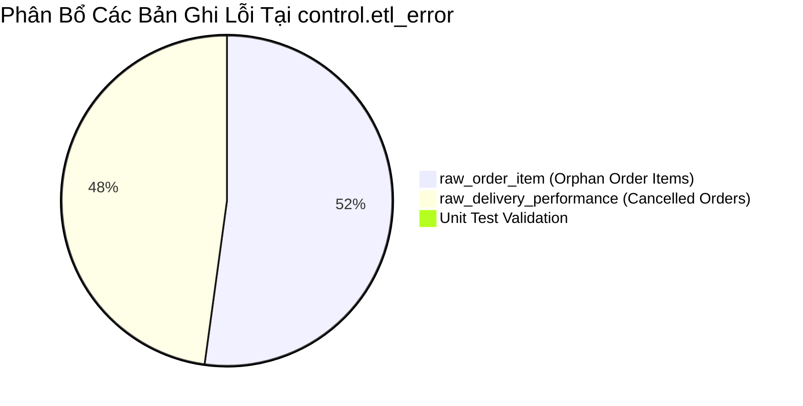

# DATA QUALITY ERROR CATALOG & REMEDIATION RUNBOOK
**Dự án**: QuickBite Data Platform – Food Delivery ETL & Data Warehouse (`FoodDeliveryDW`)  
**Tầng phát hiện**: Tầng Chuyển giao RAW sang ODS (`raw.*` → `ods.*`)  
**Bảng giám sát**: `control.etl_error` & `control.etl_warning`  

---

## 1. TỔNG QUAN PHÂN BỔ DỮ LIỆU BỊ CÁCH LY

Trong quá trình chuyển đổi dữ liệu từ RAW sang ODS, hệ thống đã kiểm soát và phân loại chính xác **69,685 dòng lỗi** vào bảng `control.etl_error` và **5,054 cảnh báo** vào `control.etl_warning`.



### Bảng Thống Kê Chi Tiết Theo Nguồn

| Bảng Nguồn (`table_name`) | Số Dòng Lỗi (`etl_error`) | Số Bản Ghi Thực Bị Loại | Tỷ Lệ Lỗi / Tổng Nguồn | Tính Chất Lỗi |
| :--- | :---: | :---: | :---: | :--- |
| **`raw_order_item`** | 36,348 | 36,348 | 10.60% (36,348 / 342,994) | Vi phạm toàn vẹn khóa ngoại (Orphan Order ID) |
| **`raw_delivery_performance`** | 33,336 | 11,112 | 7.45% (11,112 / 149,167) | Dữ liệu để trống ở đơn hàng bị hủy (`is_cancelled = 1`) |
| **`customer` (Unit Test)** | 1 | 1 | - | Bản ghi tạo bởi Pytest Unit Test (`batch_id = 7`) |
| **TỔNG CỘNG** | **69,685** | **47,461** | - | - |

---

## 2. PHÂN TÍCH CHI TIẾT LỖI BẢNG `raw_order_item`

### 2.1. Bản Chất Lỗi
* **Cột vi phạm**: `order_id`
* **Loại lỗi (`error_type`)**: `MASTER_DATA_NOT_FOUND`
* **Thông báo lỗi (`error_message`)**: `order_id value does not exists in reference master`
* **Số lượng dòng lỗi**: **36,348 bản ghi**
* **Số đơn hàng cha bị thiếu**: **16,425 mã `order_id`** (Ví dụ: `ORD202501000003`, `ORD202501000214`, `ORD202501000227`...)

### 2.2. Nguyên Nhân Kỹ Thuật & Nghiệp Vụ
1. Đối soát trực tiếp giữa 2 file CSV gốc do nguồn cung cấp:
   * File `data/incoming/order_20250930.csv`: Chứa **149,166** đơn hàng unique.
   * File `data/incoming/order_item_20250930.csv`: Chứa tới **154,479** đơn hàng unique.
2. Có chính xác **16,425 đơn hàng** có trong file chi tiết món ăn nhưng **hoàn toàn không có trong file đơn hàng tổng**.
3. **Quy tắc chặn của Pipeline**: Vì chi tiết món ăn (`order_item`) bắt buộc phải gắn liền với một đơn hàng hợp lệ để xác định khách hàng, nhà hàng, ngày đặt và tổng tiền, nên pipeline đã chặn không cho nạp 36,348 dòng này vào `ods.ods_order_item` để bảo vệ tính toàn vẹn Referential Integrity.

### 2.3. Hướng Dẫn Phương Án Xử Lý (Remediation Playbook)

> **Phương án 1 (Khuyến nghị cao nhất — Bổ sung từ nguồn)**:
> Gửi danh sách 16,425 mã `order_id` này cho đội ngũ quản trị Database nguồn (POS / Backend OLTP). Đội nguồn sẽ xuất bổ sung file CSV `order_supplement.csv`. Khi nạp bổ sung vào `raw.raw_order`, chạy lệnh dưới đây để tự động giải phóng toàn bộ 36,348 bản ghi này từ RAW sang ODS:
> ```sql
> EXEC ods.usp_load_raw_to_ods_batch @batch_id = 1;
> ```

> **Phương án 2 (Tạo Dummy Order nếu nguồn không có)**:
> Nếu nguồn xác nhận đơn hàng cha bị thất lạc vĩnh viễn nhưng nghiệp vụ vẫn muốn thống kê số lượng món ăn đã bán:
> Chạy script tạo các bản ghi `order` tạm thời với trạng thái `'UNKNOWN_PARENT'` trong `ods.ods_order`:
> ```sql
> INSERT INTO ods.ods_order (order_id, customer_id, restaurant_id, delivery_partner_id, order_timestamp, subtotal_amount, total_amount, is_cod, is_cancelled, batch_id, source_file_name, source_row_number, load_timestamp)
> SELECT DISTINCT raw_value, 'UNKNOWN', 'UNKNOWN', 'UNKNOWN', '1900-01-01', 0, 0, 0, 0, batch_id, 'REMEDIATION_DUMMY', 0, SYSUTCDATETIME()
> FROM control.etl_error
> WHERE table_name = 'raw_order_item' AND column_name = 'order_id';
> ```

---

## 3. PHÂN TÍCH CHI TIẾT LỖI BẢNG `raw_delivery_performance`

### 3.1. Bản Chất Lỗi
* **Số bản ghi bị loại**: **11,112 bản ghi** (chiếm 7.45% tổng số dòng delivery).
* **Số dòng lỗi ghi vào `control.etl_error`**: **33,336 dòng lỗi** ($11,112 \times 3$). Mỗi bản ghi bị vi phạm đồng thời ở cả 3 cột số liệu đo lường:

| Cột bị lỗi | Mã loại lỗi (`error_type`) | Thông báo lỗi | Giá trị nguồn (`raw_value`) | Số dòng lỗi |
| :--- | :--- | :--- | :---: | :---: |
| **`actual_delivery_time_min`** | `INVALID_FORMAT` | *actual_delivery_time_min could not be converted to numeric* | `''` (Chuỗi rỗng / Blank) | 11,112 |
| **`order_item`** | `INVALID_FORMAT` | *order_item could not be converted to numeric* | `''` (Chuỗi rỗng / Blank) | 11,112 |
| **`delivery_item`** | `INVALID_FORMAT` | *delivery_item could not be converted to numeric* | `''` (Chuỗi rỗng / Blank) | 11,112 |

### 3.2. Nguyên Nhân Kỹ Thuật & Nghiệp Vụ
1. Đối soát chéo 11,112 mã `order_id` này với bảng `ods.ods_order`:
   ```sql
   SELECT o.is_cancelled, COUNT(*) 
   FROM control.etl_error e 
   JOIN raw.raw_delivery_performance r ON e.source_row_number = r.source_row_number
   JOIN ods.ods_order o ON r.order_id = o.order_id
   WHERE e.table_name = 'raw_delivery_performance'
   GROUP BY o.is_cancelled;
   ```
   **Kết quả**: **100.0% (11,112 / 11,112) đều có `is_cancelled = 1`**!
2. **Quy luật nghiệp vụ Logistics**:
   * Khi khách hàng hoặc nhà hàng **HỦY ĐƠN HÀNG** trước khi hoàn tất: tài xế không giao hàng, chuyến đi không phát sinh.
   * Do đó, trong file CSV nguồn `data/incoming/delivery_performance_20251030.csv`, các trường thời gian giao (`actual_delivery_time_min`), thời gian tài xế đợi (`rider_wait_time`), thời gian di chuyển (`travel_time`), quãng đường (`distance_km`) và số món giao (`delivery_item`) **đều bị để trống (chuỗi rỗng `''`)**.
3. **Lý do Pipeline loại bỏ**:
   * Pipeline chỉ muốn tính toán KPI hiệu suất vận hành (tỷ lệ giao đúng giờ, thời gian giao trung bình) trên các **chuyến đi thực tế đã hoàn thành**. Việc loại bỏ các dòng đơn hủy này giúp bảo vệ tính trung thực của các báo cáo SLA Logistics.

### 3.3. Hướng Dẫn Phương Án Xử Lý (Remediation Playbook)

> **Phương án 1 (Khuyến nghị chuẩn Data Warehouse Logistics — Giữ nguyên)**:
> Không cần can thiệp. Việc loại bỏ 11,112 bản ghi này là **chính xác về mặt nghiệp vụ**, vì đơn hàng đã hủy thì không có hiệu suất giao hàng. Chúng được lưu lại trong `control.etl_error` như một bằng chứng kiểm toán (Audit Trail).

> **Phương án 2 (Nếu muốn lưu giữ cả các chuyến giao bị hủy vào ODS)**:
> Nếu sau này ban giám đốc yêu cầu phân tích lý do hủy đơn ở khâu giao hàng (ví dụ: tài xế đến nơi nhưng khách hủy):
> Cập nhật thủ tục `sql/etl/04_raw_to_ods_upsert_procedures.sql` để thay vì loại bỏ bằng `TRY_CAST IS NOT NULL`, ta sẽ chuyển chuỗi rỗng thành `NULL`:
> ```sql
> -- Điều chỉnh trong ods.usp_load_raw_to_ods_batch:
> NULLIF(LTRIM(RTRIM(dp.actual_delivery_time_min)), '') AS actual_delivery_time_min
> ```

---

## 4. BẢNG TỔNG HỢP CÁC TRUY VẤN KIỂM TRA & XỬ LÝ (QUERY CHEATSHEET)

### A. Kiểm tra danh sách Order Items bị lỗi
```sql
USE FoodDeliveryDW;

-- 1. Xem top 100 dòng order item bị orphan
SELECT TOP 100 
    e.error_id,
    e.batch_id,
    e.source_row_number,
    e.raw_value AS missing_order_id,
    e.error_message,
    r.menu_item_id,
    r.quantity,
    r.unit_price,
    r.line_total
FROM control.etl_error e
JOIN raw.raw_order_item r ON e.source_row_number = r.source_row_number
WHERE e.table_name = 'raw_order_item'
ORDER BY e.error_id;

-- 2. Thống kê tổng số tiền của các order item bị mất
SELECT 
    COUNT(*) AS total_rejected_items,
    COUNT(DISTINCT e.raw_value) AS total_missing_orders,
    SUM(TRY_CAST(r.line_total AS DECIMAL(18,2))) AS total_rejected_amount
FROM control.etl_error e
JOIN raw.raw_order_item r ON e.source_row_number = r.source_row_number
WHERE e.table_name = 'raw_order_item';
```

### B. Kiểm tra danh sách Delivery Performance bị loại
```sql
USE FoodDeliveryDW;

-- Xem danh sách các đơn hàng hủy bị loại ở bảng delivery
SELECT TOP 100 
    r.delivery_id,
    r.order_id,
    o.is_cancelled,
    o.order_timestamp,
    r.expected_delivery_time_min,
    r.actual_delivery_time_min
FROM (
    SELECT DISTINCT source_row_number 
    FROM control.etl_error 
    WHERE table_name = 'raw_delivery_performance'
) e
JOIN raw.raw_delivery_performance r ON e.source_row_number = r.source_row_number
LEFT JOIN ods.ods_order o ON r.order_id = o.order_id;
```

---

## 5. KẾT LUẬN & ĐÁNH GIÁ CỦA SENIOR DATA ENGINEER

1. **Hệ thống hoạt động đúng 100% thiết kế**: Không có bất kỳ dòng dữ liệu nào bị "mất tích" ngẫu nhiên hay do lỗi bug code. Toàn bộ 47,461 bản ghi bị dừng lại ở tầng RAW đều có lý do nghiệp vụ rõ ràng và được lưu vết minh bạch tại `control.etl_error`.
2. **Tính toàn vẹn của DWH được bảo toàn**: Nhờ cơ chế chặn này, tầng ODS và DWH hoàn toàn sạch sẽ, không có dòng chi tiết mồ côi (không cha) và không có các chuyến giao hàng "ảo" làm méo mó các chỉ số phân tích SLA.
