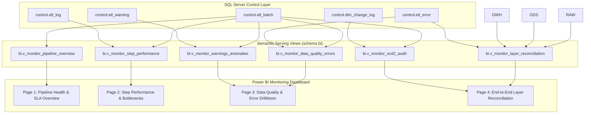

# POWER BI PIPELINE MONITORING & OBSERVABILITY DASHBOARD RUNBOOK

**Dự án**: QuickBite Data Platform – Food Delivery ETL & Data Warehouse (`FoodDeliveryDW`)  
**Mục tiêu**: Thay thế toàn bộ việc viết truy vấn kiểm tra thủ công trong SSMS hàng ngày bằng Dashboard trực quan, tự động hóa trên Power BI.  
**Tầng Serving**: Schema `bi` (`bi.v_monitor_*`)  
**Công nghệ**: SQL Server 2022 / Azure SQL, Power BI Desktop / Power BI Service  

---

## 1. TẠI SAO CẦN POWER BI PIPELINE MONITORING DASHBOARD?

### 1.1. Hiện Trạng (Pain Points với SSMS)
* **Tốn thời gian**: Mỗi buổi sáng Data Engineer / Lead phải mở SSMS, nhớ cú pháp và chạy hàng loạt câu lệnh `SELECT ... FROM control.etl_batch`, `control.etl_log`, `control.etl_error` để kiểm tra pipeline đêm qua có chạy không, có bị fail không.
* **Khó phát hiện xu hướng (Trends)**: Không thể nhìn nhanh xem thời gian chạy của pipeline đang tăng dần hay giảm dần, bước nào là "nút thắt cổ chai" (bottleneck), tỷ lệ lỗi của từng file nguồn có đang tăng đột biến không.
* **Thiếu tính trực quan cho Stakeholders**: Quản lý hoặc các thành viên khác không thể tự vào SSMS kiểm tra tình trạng dữ liệu (Data Freshness & SLA).
* **Rủi ro bỏ sót lỗi**: Khi lỗi hàng ngàn bản ghi (như 36,348 orphan records hoặc 11,112 cancelled orders), việc đọc dòng text trong SSMS rất dễ bỏ sót các mẫu hình lỗi (error patterns).

### 1.2. Giải Pháp (Power BI Observability Dashboard)
Chuyển đổi toàn bộ việc giám sát sang **Power BI Dashboard** với 5 trụ cột Data Observability:
1. **Freshness & SLA**: Dữ liệu nạp lúc mấy giờ? Trễ bao lâu? Có đạt SLA < 24h không?
2. **Volume & Throughput**: Bao nhiêu dòng nạp vào? Tốc độ xử lý (rows/sec)?
3. **Quality & Errors**: Có bao nhiêu dòng lỗi bị cách ly? Lỗi do đâu (Orphan, Sai định dạng, Null)?
4. **Lineage & Reconciliation**: Đối soát 100% dòng dữ liệu giữa RAW -> ODS -> DWH.
5. **Performance & Bottlenecks**: Bước nào chạy lâu nhất? Tốn bao nhiêu giây/phút?



---

## 2. KIẾN TRÚC SEMANTIC VIEWS CHO MONITORING

Toàn bộ các View phục vụ Power BI đã được đóng gói tại file:  
👉 [`sql/database/11_control_monitoring_views.sql`](file:///c:/Users/PC/Downloads/food-delivery-etl-dwh/sql/database/11_control_monitoring_views.sql)

| Tên View | Schema | Mục Đích | Các Trường Đo Lường Chính |
| :--- | :---: | :--- | :--- |
| **`v_monitor_pipeline_overview`** | `bi` | Tổng quan trạng thái Batch, SLA và thời gian chạy | `batch_id`, `pipeline_name`, `duration_minutes`, `batch_status`, `total_records`, `success_rate_pct`, `pipeline_health_status`, `is_latest_batch` |
| **`v_monitor_step_performance`** | `bi` | Chi tiết từng bước ETL, phát hiện nút thắt hiệu năng | `step_name`, `process_name`, `duration_seconds`, `rows_processed`, `rows_inserted`, `rows_rejected`, `throughput_rows_per_sec`, `step_status` |
| **`v_monitor_data_quality_errors`** | `bi` | Phân loại và phân tích chi tiết dữ liệu lỗi cách ly | `table_name`, `column_name`, `error_type`, `error_category`, `error_message`, `raw_value`, `source_file_name`, `source_row_number` |
| **`v_monitor_warnings_anomalies`** | `bi` | Giám sát các cảnh báo bất thường (Orphan khách hàng, đơn hủy) | `warning_type`, `entity_name`, `entity_id`, `table_name`, `order_id`, `warning_message` |
| **`v_monitor_layer_reconciliation`** | `bi` | Đối soát lượng bản ghi giữa RAW -> ODS -> DWH theo batch | `reconciliation_id`, `batch_id`, `entity_name`, `raw_rows`, `ods_rows`, `dwh_rows`, `raw_to_ods_variance`, `quarantined_error_rows`, `data_retention_rate_pct`, `audit_status` |
| **`v_monitor_scd2_audit`** | `bi` | Lịch sử thay đổi thuộc tính của Dimension (SCD Type 1 & 2) | `dimension_name`, `business_id`, `change_type`, `column_name`, `old_value`, `new_value`, `logged_at` |

---

## 3. THIẾT KẾ CHI TIẾT CÁC TRANG DASHBOARD POWER BI

Dashboard được chia thành **4 trang chuyên biệt**:

### TRANG 1: TỔNG QUAN SỨC KHỎE PIPELINE & SLA (EXECUTIVE HEALTH OVERVIEW)
> **Mục tiêu**: Dành cho Data Lead & Quản lý: Chỉ cần nhìn 3 giây là biết hệ thống đêm qua chạy thành công hay thất bại, dữ liệu có mới nhất không.

1. **Thanh KPI Header (Cards)**:
   * **Latest Batch Status**: Hiển thị badge màu (Xanh: `SUCCESS`, Đỏ: `FAILED`, Vàng: `RUNNING`/`PARTIAL`).
   * **Pipeline Health**: `Healthy` / `Warning` / `Critical`.
   * **Last Run Finished**: Ví dụ: `2026-10-16 01:32:08 (0.2 giờ trước)`.
   * **Total Records Processed**: Tổng số dòng của batch gần nhất (vd: `1,000` dòng).
   * **Success Rate**: `99.0%` (với Target: `100%`).
   * **Total Quarantine Errors**: Số dòng bị giữ lại ở tầng RAW.
2. **Batch Run History Trend (Line and Clustered Column Chart)**:
   * **Trục X**: `batch_id` / Ngày chạy.
   * **Cột (Column)**: `duration_minutes` (Thời gian chạy của từng batch).
   * **Đường (Line)**: `total_records` (Sản lượng dữ liệu).
   * **Màu cột**: Phân biệt theo `batch_status` (Xanh lục: Success, Đỏ: Failed).
3. **SLA Freshness Gauge**:
   * Đồng hồ đo số giờ kể từ lần nạp cuối (`hours_since_run`).
   * Ngưỡng xanh: < 24h, Vàng: 24h - 36h, Đỏ: > 36h.
4. **Recent Batch Execution Table**:
   * Danh sách 10 batch gần nhất với các cột: Batch ID, Pipeline Name, Start Time, Duration, Status, Total Records, Success Rate (%), Error Count.

---

### TRANG 2: HIỆU NĂNG TỪNG BƯỚC & NÚT THẮT CỔ CHAI (STEP PERFORMANCE & BOTTLENECK)
> **Mục tiêu**: Dành cho Data Engineer: Phân tích sâu bước nào trong ETL chạy chậm nhất, tốn tài nguyên nhất để tối ưu index / câu lệnh T-SQL / SSIS.

1. **Bộ Lọc (Slicers)**:
   * Chọn `batch_id` (Mặc định chọn Latest Batch).
   * Chọn `process_name` (`INGESTION`, `RAW_TO_ODS`, `ODS_TO_DWH`, `DWH_MAINTENANCE`).
2. **Top Execution Time Steps (Horizontal Bar Chart)**:
   * **Trục Y**: `step_name` (Ví dụ: `INDEX_STATS_MAINTENANCE`, `LOAD_FACT_DELIVERY_PERFORMANCE`, `LOAD_FACT_RATING`, `usp_load_fact_review_aspect`...).
   * **Trục X**: `duration_seconds`.
   * **Data Label**: Hiển thị số giây thực tế.
3. **Step Throughput & Rejection Rate (Scatter Plot hoặc Bar Chart)**:
   * Đo lường `throughput_rows_per_sec` (Số dòng xử lý trên mỗi giây).
   * Cảnh báo bước có `rejection_rate_pct > 0%`.
4. **Step Execution Detail Matrix**:
   * Cột: Step Name, Status, Start Time, End Time, Duration (s), Rows Processed, Rows Inserted, Rows Rejected, Log Message.

---

### TRANG 3: GIÁM SÁT CHẤT LƯỢNG DỮ LIỆU & TRUY VẾT LỖI (DATA QUALITY & ERROR OBSERVABILITY)
> **Mục tiêu**: Không cần viết query mò trong bảng `control.etl_error`. Xem ngay phân bố lỗi, click vào là xem được file nào, dòng số mấy, giá trị thô (`raw_value`) là gì.

1. **Error Breakdown by Category & Source Table (Donut Chart & Treemap)**:
   * **Treemap**: Nhóm theo `table_name` (`raw_order_item`, `raw_delivery_performance`, `customer`).
   * **Donut Chart**: Nhóm theo `error_category`:
     * Referential Integrity / Orphan Record (52.2%)
     * Data Type & Format Incompatibility (47.8%)
     * File Validation Error (<0.1%)
2. **Top Error Types (Bar Chart)**:
   * `MASTER_DATA_NOT_FOUND`: 36,348 bản ghi (Orphan Order Items).
   * `INVALID_FORMAT`: 33,336 bản ghi (Cancelled Delivery Performance).
3. **Operational Warnings Gauge / Card**:
   * Tổng số cảnh báo: `5,057` cảnh báo.
   * Loại cảnh báo: `ORPHAN_CUSTOMER_DETECTED`.
4. **Interactive Error Investigation Grid (Table)**:
   * Bảng chi tiết có tính năng **Search / Filter**:
     * `error_id`, `table_name`, `column_name`, `error_type`, `error_message`, `raw_value`, `source_file_name`, `source_row_number`.
   * *Người dùng có thể click vào lát cắt "raw_order_item" trên Treemap để bảng này tự động lọc toàn bộ danh sách order_id bị thiếu!*

---

### TRANG 4: ĐỐI SOÁT LUỒNG DỮ LIỆU & KIỂM TOÁN SCD2 (RECONCILIATION & AUDIT TRAIL)
> **Mục tiêu**: Chứng minh 100% tính toàn vẹn (Zero Data Loss) từ RAW sang ODS sang DWH.

1. **End-to-End Layer Reconciliation Funnel / Table**:
   * Sử dụng dữ liệu từ `bi.v_monitor_layer_reconciliation`:

| Thực Thể (`entity_name`) | Số Dòng RAW | Số Dòng ODS | Số Dòng DWH | Chênh Lệch RAW-ODS | Số Dòng Lỗi Cách Ly | Tỷ Lệ Lưu Giữ | Trạng Thái Kiểm Toán |
| :--- | :---: | :---: | :---: | :---: | :---: | :---: | :---: |
| **Customer** | 107,776 | 107,776 | 107,776 | 0 | 4 | 100.0% | `RECONCILED` |
| **Restaurant** | 19,995 | 19,995 | 19,995 | 0 | 0 | 100.0% | `RECONCILED` |
| **Delivery Partner** | 15,000 | 15,000 | 15,000 | 0 | 0 | 100.0% | `RECONCILED` |
| **Menu Item** | 342,671 | 342,671 | 342,671 | 0 | 0 | 100.0% | `RECONCILED` |
| **Order** | 149,166 | 149,166 | 149,166 | 0 | 0 | 100.0% | `RECONCILED` |
| **Order Item** | 342,994 | 306,646 | 306,646 | 36,348 | 36,348 | 89.4% | `RECONCILED` |
| **Delivery Performance**| 149,166 | 138,054 | 138,054 | 11,112 | 33,336 | 92.6% | `RECONCILED` |
| **Rating** | 68,825 | 68,825 | 68,825 | 0 | 0 | 100.0% | `RECONCILED` |

2. **Audit Status Badge**:
   * Hiển thị chữ `RECONCILED (100% AUDIT PASS)` màu xanh lá cây vì toàn bộ chênh lệch giữa RAW và ODS đều khớp 100% với số dòng lỗi bị cách ly có chủ đích trong `control.etl_error`.
3. **SCD Type 2 Dimension Change Audit Trail**:
   * Sử dụng view `bi.v_monitor_scd2_audit`:
   * Biểu đồ: Số lượng thay đổi theo Dimension (`dim_customer`, `dim_restaurant`, `dim_delivery_partner`).
   * Chi tiết: Ngày thay đổi, Tên thuộc tính bị đổi, Giá trị cũ (`old_value`) vs Giá trị mới (`new_value`).

---

## 4. BỘ CÔNG THỨC DAX CHUẨN CHO POWER BI

Tạo một bảng rỗng `_Measures` trong Power BI và thêm các công thức sau:

```dax
// 1. Batch Gần Nhất
Latest Batch ID = 
CALCULATE(
    MAX(v_monitor_pipeline_overview[batch_id]),
    ALL(v_monitor_pipeline_overview)
)

// 2. Trạng Thái Batch Gần Nhất
Latest Batch Status = 
CALCULATE(
    SELECTEDVALUE(v_monitor_pipeline_overview[batch_status]),
    FILTER(
        ALL(v_monitor_pipeline_overview),
        v_monitor_pipeline_overview[batch_id] = [Latest Batch ID]
    )
)

// 3. Chỉ Số Sức Khỏe Tổng Thể
Pipeline Health KPI = 
SWITCH(
    [Latest Batch Status],
    "SUCCESS", "🟢 Healthy",
    "RUNNING", "🔵 In Progress",
    "PARTIAL", "🟡 Degraded",
    "FAILED",  "🔴 Critical",
    "⚪ Unknown"
)

// 4. Thời Gian Kể Từ Lần Chạy Cuối (Giờ)
Hours Since Last Run = 
DATEDIFF(
    CALCULATE(
        MAX(v_monitor_pipeline_overview[start_time]),
        FILTER(ALL(v_monitor_pipeline_overview), v_monitor_pipeline_overview[batch_id] = [Latest Batch ID])
    ),
    NOW(),
    HOUR
)

// 5. Tỷ Lệ Thành Công Trung Bình (%)
Avg Success Rate Pct = 
AVERAGE(v_monitor_pipeline_overview[success_rate_pct])

// 6. Tổng Bản Ghi Lỗi Cách Ly
Total Quarantined Errors = 
COUNTROWS(v_monitor_data_quality_errors)

// 7. Tổng Bản Ghi Cảnh Báo
Total Warnings = 
COUNTROWS(v_monitor_warnings_anomalies)

// 8. Thời Gian Chạy Trung Bình (Phút)
Avg Batch Duration Min = 
AVERAGEX(
    FILTER(v_monitor_pipeline_overview, v_monitor_pipeline_overview[batch_status] = "SUCCESS"),
    v_monitor_pipeline_overview[duration_minutes]
)
```

---

## 5. HƯỚNG DẪN KẾT NỐI VÀ TRIỂN KHAI TỪNG BƯỚC

### Bước 1: Kết nối Power BI Desktop vào SQL Server
1. Mở **Power BI Desktop**.
2. Chọn **Get Data** -> **SQL Server database**.
3. Điền thông tin:
   * **Server**: `localhost\SQLEXPRESS` (hoặc tên server instance của dự án).
   * **Database**: `FoodDeliveryDW`.
   * **Data Connectivity mode**:
     * Chọn **Import** nếu muốn load dữ liệu vào bộ nhớ máy và lên lịch refresh (khuyến nghị cho báo cáo phân tích).
     * Hoặc chọn **DirectQuery** nếu muốn dashboard live 100% thời gian thực theo database.
4. Chọn **Windows Authentication** (Current credentials).
5. Trong cây đối tượng (Navigator), tích chọn **6 view** trong schema `bi`:
   * `bi.v_monitor_pipeline_overview`
   * `bi.v_monitor_step_performance`
   * `bi.v_monitor_data_quality_errors`
   * `bi.v_monitor_warnings_anomalies`
   * `bi.v_monitor_layer_reconciliation`
   * `bi.v_monitor_scd2_audit`
6. Bấm **Load**.

### Bước 2: Thiết lập Mối Quan Hệ (Data Model)
Trong tab **Model View** của Power BI:
* Liên kết `v_monitor_pipeline_overview[batch_id]` (1) ──── (N) `v_monitor_step_performance[batch_id]`.
* Liên kết `v_monitor_pipeline_overview[batch_id]` (1) ──── (N) `v_monitor_data_quality_errors[batch_id]`.
* Liên kết `v_monitor_pipeline_overview[batch_id]` (1) ──── (N) `v_monitor_warnings_anomalies[batch_id]`.
* Liên kết `v_monitor_pipeline_overview[batch_id]` (1) ──── (N) `v_monitor_scd2_audit[batch_id]`.
* Liên kết `v_monitor_pipeline_overview[batch_id]` (1) ──── (N) `v_monitor_layer_reconciliation[batch_id]`.

### Bước 3: Cài đặt Lịch Tự Động Refresh & Cảnh Báo (Alerts)
1. Xuất bản (Publish) file lên **Power BI Service** (Workplace: *Food Delivery Analytics*).
2. Thiết lập **Scheduled Refresh**:
   * Cài đặt refresh tự động sau mỗi lần Job SQL Server Agent hoàn thành (ví dụ: vào 02:30 AM hàng ngày).
3. Thiết lập **Data Alert** (Thông báo tự động):
   * Trên Card `Pipeline Health KPI` hoặc `Latest Batch Status`:
   * Tạo Alert: Nếu `Latest Batch Status = FAILED` -> Tự động gửi Email hoặc bắn tin nhắn vào Microsoft Teams / Slack của đội Data Engineering.

---

## 6. SO SÁNH: SSMS QUERIES VS POWER BI MONITORING

| Tiêu Chí | Kiểm Tra Bằng SSMS (Cũ) | Power BI Dashboard (Mới) |
| :--- | :--- | :--- |
| **Thao tác** | Mở SSMS, kết nối DB, gõ 5-10 câu lệnh T-SQL | Mở link Power BI trên trình duyệt hoặc điện thoại |
| **Thời gian kiểm tra** | Mất 5 - 15 phút mỗi sáng | Mất **3 giây** nhìn thẻ trạng thái xanh/đỏ |
| **Phát hiện chậm (Bottleneck)** | Phải cộng trừ `DATEDIFF` thủ công từng dòng log | Biểu đồ thanh sắp xếp tự động từ lâu nhất đến nhanh nhất |
| **Điều tra lỗi** | Nhìn text thô hàng chục ngàn dòng trong Grid SSMS | Biểu đồ tròn + Treemap phân loại rõ ràng, lọc tương tác 1-click |
| **Đối soát thất thoát** | Viết lệnh JOIN phức tạp giữa 8 bảng | Bảng đối soát tự động hiển thị tỷ lệ lưu giữ và cờ PASS/FAIL |
| **Cảnh báo tự động** | Không có (chỉ biết khi có người mở SSMS ra xem) | Tự động bắn email / thông báo khi pipeline gặp sự cố |
