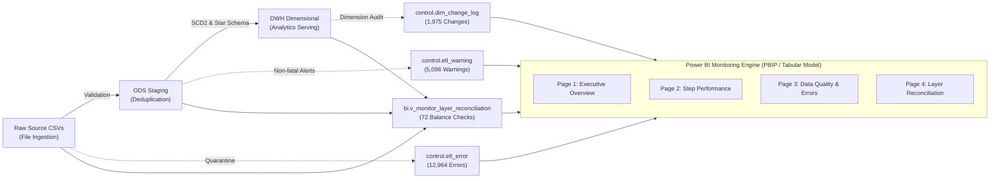
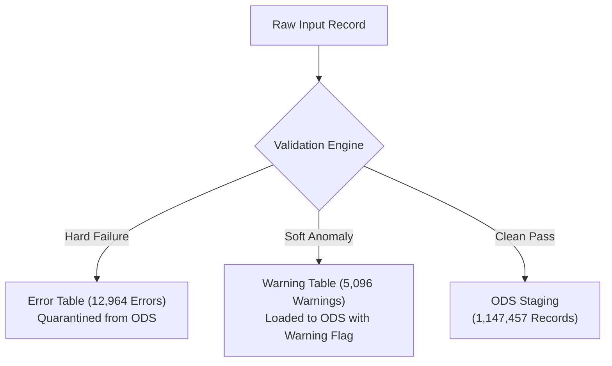

# QuickBite Pipeline Monitoring & Observability Dashboard
## Dashboard User Guide & Technical Specification

Trained on the **QuickBite Data Platform** (Microsoft Fabric / Power BI Desktop & SQL Server), this document serves as the comprehensive user manual, architecture specification, and on-call operational playbook for the 4-page **Pipeline Monitoring & Observability Dashboard**.

---

## Table of Contents
1. [Observability Architecture Overview](#1-observability-architecture-overview)
2. [Page 1: Executive Health & SLA Overview](#2-page-1-executive-health--sla-overview)
   - 2.1. [Design Principles & The 3-Second Rule](#21-design-principles--the-3-second-rule)
   - 2.2. [5-KPI Card Callout & Subtext Specification](#22-5-kpi-card-callout--subtext-specification)
   - 2.3. [Charts Deep Dive & Metric Semantics](#23-charts-deep-dive--metric-semantics)
   - 2.4. [Recent Batches Grid & Cross-Filtering](#24-recent-batches-grid--cross-filtering)
   - 2.5. [Incident Triage Playbook](#25-incident-triage-playbook)
3. [Page 2: Step Performance & Bottlenecks](#3-page-2-step-performance--bottlenecks)
   - 3.1. [Macro-to-Micro Latency Analysis](#31-macro-to-micro-latency-analysis)
   - 3.2. [5-KPI Card Callout & Subtext Specification](#32-5-kpi-card-callout--subtext-specification)
   - 3.3. [Technical Deep-Dive Notes on KPI Cards](#33-technical-deep-dive-notes-on-kpi-cards)
   - 3.4. [Charts Deep Dive & Metric Semantics](#34-charts-deep-dive--metric-semantics)
   - 3.5. [Step Execution Grid & Interactive Slicers](#35-step-execution-grid--interactive-slicers)
   - 3.6. [Performance Tuning Playbook](#36-performance-tuning-playbook)
4. [Page 3: Data Quality & Errors](#4-page-3-data-quality--errors)
   - 4.1. [Dual Quarantine Architecture (Hard vs. Soft Defects)](#41-dual-quarantine-architecture-hard-vs-soft-defects)
   - 4.2. [5-KPI Card Callout & Subtext Specification](#42-5-kpi-card-callout--subtext-specification)
   - 4.3. [Technical Deep-Dive Notes on KPI Cards](#43-technical-deep-dive-notes-on-kpi-cards)
   - 4.4. [Bookmark Chart System Deep Dive](#44-bookmark-chart-system-deep-dive)
   - 4.5. [Dual Bookmark Investigation Grids](#45-dual-bookmark-investigation-grids)
   - 4.6. [Data Quality Remediation Playbook](#46-data-quality-remediation-playbook)
5. [Page 4: Layer Reconciliation & Audit](#5-page-4-layer-reconciliation--audit)
   - 5.1. [End-to-End Zero Unaccounted Loss Principle](#51-end-to-end-zero-unaccounted-loss-principle)
   - 5.2. [5-KPI Card Callout & Subtext Specification](#52-5-kpi-card-callout--subtext-specification)
   - 5.3. [3-Layer Balance Equation (RAW ➔ ODS ➔ DWH)](#53-3-layer-balance-equation-raw--ods--dwh)
   - 5.4. [End-to-End Layer Reconciliation Matrix](#54-end-to-end-layer-reconciliation-matrix)
   - 5.5. [SCD Type 2 Dimension Audit Analytics](#55-scd-type-2-dimension-audit-analytics)
   - 5.6. [Reconciliation Audit Playbook](#56-reconciliation-audit-playbook)

---

## 1. Observability Architecture Overview

The monitoring system provides complete transparency across data flow, latency, quality, and reconciliation from raw files to the analytical serving layer:

* **Storage Mode**: Import (In-Memory Tabular / VertiPaq Engine).
* **Database Connection**: `localhost\SQLEXPRESS` (`FoodDeliveryDW`), Serving Views in schema `bi`.
* **Theme**: Official QuickBite Platinum Silver Luxury Theme (`quickbite_theme_platinum_silver.json`).

---

## 2. Page 1: Executive Health & SLA Overview

### 2.1. Design Principles & The 3-Second Rule
Designed for **Lead Data Engineers, DevOps, and Platform Directors**. The page enforces the **3-Second Rule**: within 3 seconds of opening, an engineer must ascertain:
1. Did the latest batch complete successfully?
2. Has data freshness exceeded the SLA threshold?
3. How many records reached the DWH vs. quarantined errors?

### 2.2. 5-KPI Card Callout & Subtext Specification
Positioned across the top banner (`y = 220, h = 160`) using the modern **Card Visual** (`cardVisual`):

| Card # | Main Metric (Callout) | Dynamic Subtext Measure | Business Interpretation & Thresholds |
| :---: | :--- | :--- | :--- |
| **1** | `[Latest Batch ID Label]` (`Batch #9`) | `[Latest Batch Subtext]` (`Status: 🟢 SUCCESS \| Processed: 40,782`) | Identifies the most recent execution run and record count. |
| **2** | `[Latest Batch Duration]` (`12s`) | `[Batch Duration Subtext]` (`Ingestion Velocity: 3,398.5 rows/s`) | Total execution runtime and ingestion speed. |
| **3** | `[Total Records Loaded DWH]` (`1,149,415`) | `[Records to DWH Subtext]` (`RAW Ingested: 1,161,911 \| Retention: 98.9%`) | Net volume delivered to warehouse vs. raw input. |
| **4** | `[Total Quarantined Errors]` (`12,964`) | `[Quarantined Errors Subtext]` (`Rejection Rate: 1.12% \| Defects: 1,852`) | Defective rows intercepted by quarantine validation. |
| **5** | `[Total Operational Warnings]` (`5,096`) | `[Operational Warnings Subtext]` (`Anomaly Rate: 0.44% \| Orphan Cust: 5,096`) | Non-fatal business anomalies staged in ODS. |

### 2.3. Charts Deep Dive & Metric Semantics

#### 1. Visual: `Batch History Trend` (Line & Clustered Column Chart)
* **X-Axis**: `Batch[batch_id]` (`Batch #1` to `Batch #9`).
* **Column Y-Axis**: `[Batch Total Records]` (Volumes ingested per batch).
* **Line Y-Axis**: `[Batch Duration Sec]` (Batch runtime in seconds).
* **Conditional Formatting**: Columns dynamically colored via `[Batch Status Color]` (`#009E46` Green for SUCCESS, `#C40C0C` Red for FAILED, `#D97706` Amber for RUNNING).

#### 2. Visual: `SLA Freshness Gauge` (Radial Gauge Chart)
* **Value**: `[Hours Since Last Run]` (Elapsed hours since latest run).
* **Target Value**: `[SLA Target Hours]` (`24h`).
* **Maximum Value**: `[SLA Max Hours]` (`48h`).
* **Pointer Color**: Controlled by `[SLA Status Color]` (`#009E46` Green if `≤ 24h`, `#D97706` Amber if `24–36h`, `#C40C0C` Red if `> 36h`).

### 2.4. Recent Batches Grid & Cross-Filtering
Located across the bottom half (`y = 740`), displaying detailed batch execution records:
* **Columns**: `batch_id`, `pipeline_name`, `start_time`, `end_time`, `duration_minutes`, `batch_status`, `total_records`, `success_records`, `error_records`, `success_rate_pct`.
* **Cross-Filtering**: Clicking any batch row dynamically isolates all 5 KPI cards, duration trends, and SLA status to that specific batch.

### 2.5. Incident Triage Playbook
* **Scenario A: Batch Status = FAILED (Red `#C40C0C`)**:
  1. Click the failed batch in the Recent Batches Grid to inspect failure time and volume.
  2. Navigate to **Page 2 (Step Performance)** to identify the exact step triggering the abort.
  3. Navigate to **Page 3 (Data Quality & Errors)** to inspect raw payload causing the defect.
* **Scenario B: SLA Freshness Gauge > 24h (Amber/Red)**:
  1. Verify upstream scheduler (Airflow/SSIS Agent/CRON) heartbeat.
  2. Inspect source SFTP/S3 bucket for delayed vendor CSV arrivals.

---

## 3. Page 2: Step Performance & Bottlenecks

### 3.1. Macro-to-Micro Latency Analysis
Focuses on individual step execution times, processing velocities, and pipeline stages across the 198 executed steps.

### 3.2. 5-KPI Card Callout & Subtext Specification

| Card # | Main Metric (Callout) | Dynamic Subtext Measure | Technical Description & Scope |
| :---: | :--- | :--- | :--- |
| **1** | `[Total Steps Label]` (`198 Steps`) | `[Step Execution Subtext]` (`🟢 198 Success \| 0 Failed \| 0 Running`) | Total executed task logs in `Step` table. |
| **2** | `[Total Process Stages Label]` (`6 Stages`) | `[Process Stages Subtext]` (`Top Stage: ODS_TO_DWH (66 steps)`) | Distinct functional processes (`INGESTION`, `ODS_TO_DWH`, etc.). |
| **3** | `[Total Step Duration Label]` (`2m 40s`) | `[Step Duration Subtext]` (`Max Step: 10s \| Avg Step: 1s`) | Cumulative CPU/runtime across all steps. |
| **4** | `[Total Step Rows Processed]` (`4,713,492`) | `[Step Rows Subtext]` (`Inserted: 4,701,000 \| Yield: 99.73%`) | Total volume processed across all pipeline stages. |
| **5** | `[Total Step Rows Rejected]` (`12,492`) | `[Step Rejected Subtext]` (`Avg Rejection Rate: 0.27% \| Stages: 1/6`) | Physical records dropped at step level. |

### 3.3. Technical Deep-Dive Notes on KPI Cards
* **Total Rows Processed (`4,713,492`) vs. Total Records (`1,161,911`)**:
  Because an end-to-end pipeline routes records through multiple sequential stages (`File Ingestion ➔ Staging ODS ➔ Dimension Lookup ➔ Fact Loading`), each physical row is counted at every transformation step. A yield rate of `99.73%` confirms high pipeline efficiency.

### 3.4. Charts Deep Dive & Metric Semantics

#### 1. Visual Left: `Top Execution Time Steps` (Clustered Bar Chart)
* **Y-Axis**: `Step[step_name]` (Ordered descending by execution time).
* **X-Axis**: `[Total Step Duration Sec]`.
* **Diagnostic Value**: Identifies the primary bottleneck steps (e.g., `LOAD_FACT_DELIVERY_PERFORMANCE` taking `10s`, `INDEX_STATS_MAINTENANCE` taking `6s`).

#### 2. Visual Right: `Step Throughput & Processing Velocity` (Clustered Bar Chart)
* **Y-Axis**: `Step[process_name]`.
* **X-Axis**: `[Step Throughput (Rows/Sec)]`.
* **Diagnostic Value**: Measures processing throughput to identify whether bottleneck steps are caused by heavy volume or unoptimized SQL queries.

### 3.5. Step Execution Grid & Interactive Slicers
* **Interactive Slicers**: `Batch ID`, `Process Stage`, `Step Status`.
* **Execution Grid Columns**: `log_id`, `batch_id`, `process_name`, `step_name`, `step_status`, `duration_seconds`, `rows_processed`, `rows_inserted`, `rows_rejected`, `rejection_rate_pct`, `throughput_rows_per_sec`, `message`.

### 3.6. Performance Tuning Playbook
* **If Duration > 30s on Fact Loading**:
  1. Inspect `throughput_rows_per_sec`. If < 5,000 rows/s, verify database indexes and table partitioning.
  2. Check for locking or lock escalation during index maintenance steps.

---

## 4. Page 3: Data Quality & Errors

### 4.1. Dual Quarantine Architecture (Hard vs. Soft Defects)
Distinguishes between **Fatal Data Quality Violations** (diverted to quarantine) and **Non-fatal Operational Warnings** (admitted to ODS with audit flags):

### 4.2. 5-KPI Card Callout & Subtext Specification

| Card # | Main Metric (Callout) | Dynamic Subtext Measure | Technical Scope & Diagnostics |
| :---: | :--- | :--- | :--- |
| **1** | `[Total Quarantined Errors]` (`12,964`) | `[Error Drilldown Subtext]` (`Rejected Rows: 12,492 \| Multi-fault: 472`) | Total error violation events recorded in `Error` table. |
| **2** | `[True Data Defects]` (`1,852`) | `[Data Defects Subtext]` (`Impact: 14.3% \| Cancelled Orders: 11,112`) | True technical defect events excluding business cancellations. |
| **3** | `[Affected Files Label]` (`36 Files`) | `[Affected Files Subtext]` (`Total Files: 72 \| Tables: 4/8 Affected`) | Distinct source CSV files containing invalid records. |
| **4** | `[Violated Columns Label]` (`12 Columns`) | `[Violated Columns Subtext]` (`DQ Rules: 7 \| Categories: 3`) | Distinct database columns with schema or business rule breaches. |
| **5** | `[Total Operational Warnings]` (`5,096`) | `[Warning Drilldown Subtext]` (`Tables: 1/8 Affected \| Warning Types: 2`) | Non-fatal anomaly records logged in `Warning` table. |

### 4.3. Technical Deep-Dive Notes on KPI Cards
* **Total Quarantined Errors (`12,964`) vs. Physical Rejected Rows (`12,492`)**:
  * An individual physical record can violate multiple validation rules simultaneously (e.g., an invalid timestamp and an orphan foreign key).
  * `12,492` rejected physical rows triggered `12,964` error events, accounting for **472 multi-fault occurrences**.
* **Total Quarantined Errors (`12,964`) vs. True Data Defects (`1,852`)**:
  * `11,112` errors are categorized under `EXCLUDED_ORDER_CANCELLED` (business-mandated exclusion of cancelled orders).
  * True data defects represent `1,852` events (`14.3%`), primarily schema, data type, and orphan referential defects.

### 4.4. Bookmark Chart System Deep Dive
Controlled via the Bookmark Navigator at `y = 390`:

#### Group 1: Structural & Root-Cause Distribution (`Bookmark: dq_errors`)
* **Bar Chart (Left)**: `Top Quarantined Error Types by Frequency` (Categorized by `error_type`).
* **Donut Chart (Right)**: `Quarantined Errors by Category & Source` (Categorized by `error_category` and `table_name`).

#### Group 2: Temporal Trends & Rejection Rates (`Bookmark: dq_trends`)
* **Left Chart**: `Quarantined Errors & Rejection Rate by Batch` (Stacked columns for error volume; Line for `[Quarantined Error Rate Pct]` against RAW input).
* **Right Chart**: `Operational Warnings & Anomaly Rate by Batch` (Stacked columns for warnings; Line for `[Operational Warning Rate Pct]` against ODS staged volume).
* **The Batch Trend Paradox**:
  * Absolute error counts decline from `1,643` in Batch #1 to `1,221` in Batch #9.
  * However, total batch input drops sharply from Batch #6–#9 (~40k rows), causing the **error percentage to surge from 0.37% to 3.15%**.

### 4.5. Dual Bookmark Investigation Grids
* **Bookmark `dq_errors`**: Opens the `Quarantined Error Investigation Grid` (`error_id`, `batch_id`, `table_name`, `column_name`, `error_type`, `raw_value`, `source_file_name`, `source_row_number`, `error_timestamp`).
* **Bookmark `dq_warnings`**: Opens the `Operational Warning Investigation Grid` (`warning_id`, `batch_id`, `entity_name`, `entity_id`, `warning_type`, `warning_message`, `warning_timestamp`).

### 4.6. Data Quality Remediation Playbook
* **Referential Integrity Failures (`MASTER_DATA_NOT_FOUND`)**:
  * Inspect `source_file_name` and `raw_value`. Check whether dimension extract files (Customer/Restaurant) ran prior to fact extraction.
* **Format Incompatibility (`INVALID_FORMAT`)**:
  * Inspect source CSV delimiter handling or unexpected string characters in numeric/date columns.

---

## 5. Page 4: Layer Reconciliation & Audit

### 5.1. End-to-End Zero Unaccounted Loss Principle
Guarantees that **every single ingested raw row** is mathematically accounted for across the data warehouse lifecycle.

### 5.2. 5-KPI Card Callout & Subtext Specification

| Card # | Main Metric (Callout) | Dynamic Subtext Measure | Technical Scope & Accounting |
| :---: | :--- | :--- | :--- |
| **1** | `[Reconciliation Checks Label]` (`72 Checks`) | `[Reconciliation Checks Subtext]` (`🟢 67 Exact Match \| 🟡 5 SCD Variances`) | Audit check runs across 8 entities and 9 batches. |
| **2** | `[Total Records Staged ODS]` (`1,147,457`) | `[ODS Staged Subtext]` (`RAW: 1,161,911 \| Deduped: 1,962 rows`) | Valid clean records staged into ODS. |
| **3** | `[Total Records Loaded DWH]` (`1,149,415`) | `[DWH Loaded Subtext]` (`SCD2 Versions: +1,958 \| Unaccounted: 🟢 0`) | Physical analytical rows stored in DWH. |
| **4** | `[Overall Data Retention Rate Pct]` (`98.92%`) | `[Retention Rate Subtext]` (`🟢 Healthy (>= 98%) \| Net Diff: -12,496`) | Proportion of raw data retained into DWH. |
| **5** | `[Total Dimension Changes]` (`1,975`) | `[Dimension Changes Subtext]` (`Unique Keys: 1,941 \| Dims: 3 \| Attrs: 4`) | Slowly Changing Dimension audit changes logged. |

### 5.3. 3-Layer Balance Equation (RAW ➔ ODS ➔ DWH)
The exact mathematical reconciliation across all 9 batches:

$$\text{RAW Records } (1,161,911) - \text{ODS Records } (1,147,457) = \mathbf{14,454} \text{ (RAW-ODS Variance)}$$

$$\mathbf{14,454} = \mathbf{12,492} \text{ (Quarantined Error Rows)} + \mathbf{1,962} \text{ (SCD Deduplicated Rows)}$$

* **12,492 Quarantined Error Rows**: Physically rejected defective rows.
* **1,962 SCD Deduplicated Rows**: Multiple updates within the same batch for Customer (1,454), Restaurant (187), and Delivery Partner (321) collapsed to current snapshot in ODS.

$$\text{ODS Records } (1,147,457) \xrightarrow{+1,958 \text{ SCD2 Versions}} \text{DWH Records } (1,149,415)$$

* **ODS-DWH Variance (`-1,958`)**: DWH expands by 1,958 rows due to SCD Type 2 historical record versioning (`dim_customer`: +1,454, `dim_delivery_partner`: +317, `dim_restaurant`: +187).
* **Unaccounted Record Loss**: $\mathbf{0}$ records (`Unaccounted = 0`).

### 5.4. End-to-End Layer Reconciliation Matrix
Located at `y = 410`, auditing all 72 reconciliation checks:
* **Columns**:
  1. `batch_id`
  2. `entity_name`
  3. `RAW Ingested` (`[Total Records Ingested RAW]`)
  4. `ODS Staged` (`[Total Records Staged ODS]`)
  5. `DWH Loaded` (`[Total Records Loaded DWH]`)
  6. `RAW-ODS Variance` (`[Total RAW to ODS Variance]`)
  7. `ODS-DWH Variance` (`[Total ODS to DWH Variance]`)
  8. `Quarantined Errors` (`[Total Reconciliation Errors]`)
  9. `Retention Rate` (`[Overall Data Retention Rate Pct]`)
  10. `Audit Status` (`Reconciliation[audit_status]`) — Colored dynamically via `[Audit Status Color]` (`#009E46` Green for `RECONCILED (Valid Audit)`, `#C40C0C` Red for `VARIANCE DETECTED`).

### 5.5. SCD Type 2 Dimension Audit Analytics

#### 1. Left Chart: `Dimension Historical Changes by Entity & Attribute`
* **X-Axis**: `Audit[dimension_name]` (`dim_customer`, `dim_delivery_partner`, `dim_restaurant`).
* **Y-Axis**: `[Total Dimension Changes]`.
* **Legend**: `Audit[column_name]` (Tracking attribute updates across `rating`, `vehicle_type`, `is_active`, `loyalty_tier`).

#### 2. Right Table: `SCD Attribute Change Audit Log`
* **Columns**: `change_log_id`, `batch_id`, `dimension_name`, `business_id`, `change_type`, `column_name`, `old_value`, `new_value`, `effective_date`.
* **Traceability**: Provides granular row-level audit trails of historical dimension version transitions.

### 5.6. Reconciliation Audit Playbook
* **If `Audit Status` = VARIANCE DETECTED (Red `#C40C0C`)**:
  1. Verify whether `RAW-ODS Variance` equals `Quarantined Errors + Deduplicated Rows`.
  2. If variance exceeds errors, inspect for partial file loads or unhandled duplicate keys.
  3. Verify that all surrogate keys in DWH resolve to valid dimensional natural keys.
