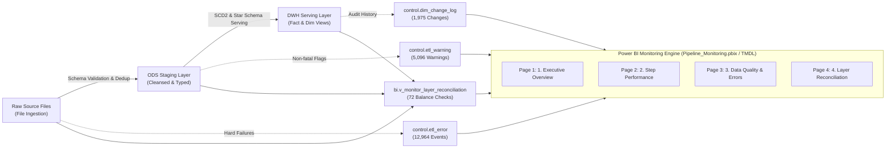
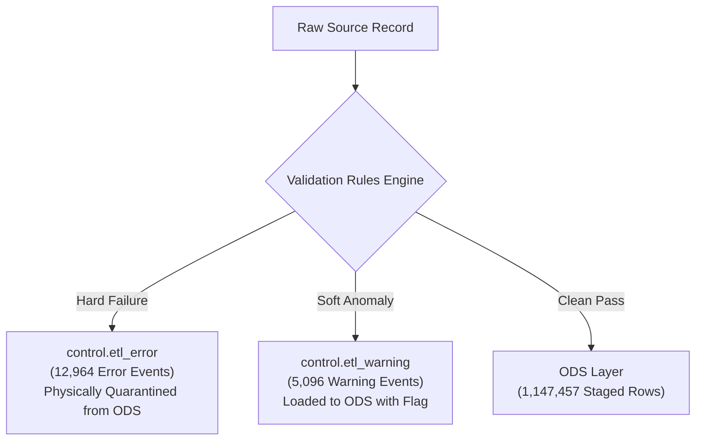

# QuickBite Pipeline Monitoring & Observability Dashboard
## Dashboard User Guide & Technical Specification

Trained on the **QuickBite Data Platform** (Microsoft Fabric / Power BI Desktop & SQL Server `FoodDeliveryDW`), this document serves as the authoritative, up-to-date technical specification, architectural reference, and operational playbook for the 4-page **Pipeline Monitoring & Observability Dashboard** (`Pipeline_Monitoring.pbix`).

---

## Table of Contents
1. [Observability Architecture & Design Philosophy](#1-observability-architecture--design-philosophy)
2. [Master Layout, Navigation & Visual Hierarchy](#2-master-layout-navigation--visual-hierarchy)
3. [Page 1: Executive Overview](#3-page-1-executive-overview)
   - 3.1. [Core Purpose & The 3-Second Rule](#31-core-purpose--the-3-second-rule)
   - 3.2. [Interactive Slicers](#32-interactive-slicers)
   - 3.3. [5-KPI Card Callouts & Subtext Specification](#33-5-kpi-card-callouts--subtext-specification)
   - 3.4. [Charts & Grid Deep Dive](#34-charts--grid-deep-dive)
   - 3.5. [Executive Incident Triage Playbook](#35-executive-incident-triage-playbook)
4. [Page 2: Step Performance](#4-page-2-step-performance)
   - 4.1. [Micro-Level Latency & Pipeline Stages](#41-micro-level-latency--pipeline-stages)
   - 4.2. [Interactive Slicers](#42-interactive-slicers)
   - 4.3. [5-KPI Card Callouts & Subtext Specification](#43-5-kpi-card-callouts--subtext-specification)
   - 4.4. [Execution Velocity & Bottleneck Charts](#44-execution-velocity--bottleneck-charts)
   - 4.5. [Step Execution Grid & Performance Tuning Playbook](#45-step-execution-grid--performance-tuning-playbook)
5. [Page 3: Data Quality & Errors](#5-page-3-data-quality--errors)
   - 5.1. [Dual Quarantine Architecture (Hard Defects vs. Soft Anomalies)](#51-dual-quarantine-architecture-hard-defects-vs-soft-anomalies)
   - 5.2. [Interactive Slicers](#52-interactive-slicers)
   - 5.3. [5-KPI Card Callouts & Subtext Specification](#53-5-kpi-card-callouts--subtext-specification)
   - 5.4. [Triple Bookmark Navigation System](#54-triple-bookmark-navigation-system)
   - 5.5. [Dual Deep Investigation Grids](#55-dual-deep-investigation-grids)
   - 5.6. [Data Quality Remediation Playbook](#56-data-quality-remediation-playbook)
6. [Page 4: Layer Reconciliation](#6-page-4-layer-reconciliation)
   - 6.1. [End-to-End Zero Unaccounted Loss Principle](#61-end-to-end-zero-unaccounted-loss-principle)
   - 6.2. [Interactive Slicers](#62-interactive-slicers)
   - 6.3. [5-KPI Card Callouts & Subtext Specification](#63-5-kpi-card-callouts--subtext-specification)
   - 6.4. [3-Layer Data Balance Equations (RAW ➔ ODS ➔ DWH)](#64-3-layer-data-balance-equations-raw--ods--dwh)
   - 6.5. [Reconciliation Matrix & SCD Type 2 Audit Visuals](#65-reconciliation-matrix--scd-type-2-audit-visuals)
   - 6.6. [Reconciliation Audit Playbook](#66-reconciliation-audit-playbook)

---

## 1. Observability Architecture & Design Philosophy

The monitoring system provides complete, mathematically verified transparency across data flow, latency, quality, and dimensional integrity from source CSV ingestion to analytical serving:



* **Target Audience**: Lead Data Engineers, Platform DevOps/SRE, Data Warehouse Architects, and Engineering Leadership.
* **Storage Mode**: Import (In-Memory Tabular VertiPaq Engine, Compatibility Level `1606`).
* **Source Database**: `localhost\SQLEXPRESS` (`FoodDeliveryDW`), semantic serving views in schema `bi`.
* **Visual Theme**: Official QuickBite Platinum Silver Luxury Theme (`quickbite_theme_platinum_silver.json`).
* **Canvas Resolution**: Standard 16:9 widescreen ($1920 \times 1080\text{ px}$).

---

## 2. Master Layout, Navigation & Visual Hierarchy

Each page shares a unified structural layout optimized for operational ergonomics:

1. **Top Header Bar (`y = 0` to `90 px`, `w = 1920 px`)**:
   * **Logo**: QuickBite / GrabFood emblem (`x = 40, y = 20, w = 50, h = 50`).
   * **Page Title Box**: Clear section indicator (`x = 105, y = 18, w = 500, h = 70`).
   * **Global Page Navigation**: 4 interconnected interactive navigation shapes at `y = 0, h = 70` (`Executive Overview`, `Step Performance`, `Data Quality`, `Layer Reconciliation`) providing seamless one-click switching.
   * **Top Slicers Bar (`y = 20, h = 60`)**: Placed on the right header quadrant (`x = 690` to `1890`) for instant contextual slicing.
2. **KPI Banner Area (`y = 195` to `355 px`, `w = 1860 px`, `h = 160 px`)**:
   * Built on Power BI's modern **New Card Visual** (`cardVisual`).
   * Houses **5 standardized KPI cards** per page, each featuring a large **Callout Value** paired with an intelligent DAX **Reference Label Subtext** displaying secondary operational context, historical benchmarks, and dynamic health badges (🟢/🟡/🔴).
3. **Primary Analytics Grid (`y = 380` to `715 px`, `h = 335 px`)**:
   * Dual visual split or full-width matrix presenting operational trends, radial SLA gauges, bottleneck rankings, or bookmark-toggled charts.
4. **Detailed Investigation Grid (`y = 735` to `1060 px`, `h = 325 px`)**:
   * Interactive tabular grids allowing row-level drill-down, audit traceability, and root-cause analysis.

---

## 3. Page 1: Executive Overview

### 3.1. Core Purpose & The 3-Second Rule
Designed for **Engineering Leads & DevOps**. The page enforces the **3-Second Rule**: within 3 seconds of opening, an on-call engineer must instantly verify:
1. Did the latest batch complete successfully or with partial quarantine?
2. Has data freshness breached the 24-hour SLA threshold?
3. What is the total volume delivered to the DWH vs. quarantined errors?

### 3.2. Interactive Slicers
Located in the upper right header banner (`y = 20, h = 60`):
* **`Batch ID`** (`x = 1470, w = 200`): Dropdown filter on `Batch[batch_id]` (Batches #1 through #9).
* **`Batch Status`** (`x = 1690, w = 200`): Dropdown filter on `Batch[batch_status]` (`SUCCESS`, `PARTIAL`, `FAILED`, `RUNNING`).

### 3.3. 5-KPI Card Callouts & Subtext Specification
Unified inside `cardVisual` (`x = 30, y = 195, w = 1860, h = 160`):

| Card # | Callout Measure | Current Live Value | Reference Label Subtext Measure | Live Dynamic Subtext String | Health Thresholds & Diagnostics |
| :---: | :--- | :---: | :--- | :--- | :--- |
| **1** | `[Latest Batch ID Label]` | **`Batch #9`** | `[Latest Batch Subtext]` | `Status: 🟡 PARTIAL \| Rejected: 1,174 rows` | Identifies the most recent run, operational status, and record rejection counts. |
| **2** | `[Latest Batch Duration]` | **`12s`** | `[Batch Duration Subtext]` | `Throughput: 🟡 3.3k rows/s \| Median: 4.6k` | Runtime duration compared against the system historical median throughput. |
| **3** | `[Total Records Loaded DWH]` | **`1,149,415`** | `[Records to DWH Subtext]` | `RAW: 1,161,911 \| Retention Rate: 🟢 98.92%` | Net volume delivered to analytics serving vs. raw ingestion. Retention $\ge 98\%$ is 🟢 Healthy. |
| **4** | `[Total Quarantined Errors]` | **`12,964`** | `[Quarantined Errors Subtext]` | `Error Rate: 1.12% \| 🟢 Normal (< 2.0%)` | Intercepted defect rows quarantined from ODS. Error rate $< 2.0\%$ is 🟢 Normal. |
| **5** | `[Total Operational Warnings]`| **`5,096`** | `[Operational Warnings Subtext]` | `Warning Rate: 0.44% \| 🟢 Normal (< 2.0%)` | Non-fatal anomalies admitted to ODS with audit flags. Warning rate $< 2.0\%$ is 🟢 Normal. |

### 3.4. Charts & Grid Deep Dive

#### 1. Visual: `Data Freshness & SLA Compliance` (Radial Gauge Chart)
* **Position**: `x = 30, y = 380, w = 620, h = 335`.
* **Value**: `_Measures[Hours Since Last Run]` (Elapsed hours since latest execution).
* **Target Value**: `[SLA Target Hours]` ($24\text{h}$).
* **Maximum Scale**: `[SLA Max Hours]` ($48\text{h}$).
* **Dynamic Pointer Color**: Driven by `[SLA Status Color]` (`#009E46` Green if $\le 24\text{h}$, `#FF8F00` Orange if $24\text{--}36\text{h}$, `#C40C0C` Red if $> 36\text{h}$).

#### 2. Visual: `Batch Run History & Ingestion Trend` (Line & Clustered Column Combo Chart)
* **Position**: `x = 670, y = 380, w = 1220, h = 335`.
* **X-Axis (Category)**: `Batch[batch_id]` (`Batch #1` to `Batch #9`).
* **Column Y-Axis**: `_Measures[Batch Total Records]` (Volume scale from $39\text{k}$ to $445\text{k}$ rows).
* **Line Y-Axis (Y2)**: `_Measures[Batch Duration Sec]` (Batch execution time in seconds, ranging from $10\text{s}$ to $42\text{s}$).
* **Diagnostic Value**: Correlates volume spikes with processing latency to assess pipeline scaling stability.

#### 3. Visual: `Recent Pipeline Execution Log` (Interactive Table Grid)
* **Position**: `x = 30, y = 735, w = 1860, h = 325`.
* **Columns**: `Batch ID`, `Pipeline Name`, `Start Time`, `Duration Seconds`, `Batch Status`, `Total Records`, `Success Records`, `Error Records`, `Success Rate (%)`.
* **Interactivity**: Clicking any row cross-filters all 5 KPI cards, the SLA gauge, and trend lines to isolate that specific batch.

### 3.5. Executive Incident Triage Playbook
* **Scenario A: Batch Status = PARTIAL (Amber) or FAILED (Red)**:
  1. Inspect `Error Records` in the *Recent Pipeline Execution Log*.
  2. Click the affected batch row to filter the entire dashboard.
  3. Click **Step Performance** in the top navigation to pinpoint the failing procedure.
  4. Navigate to **Data Quality & Errors** to inspect the offending raw payload.
* **Scenario B: Data Freshness Gauge > 24 Hours (Amber/Red SLA Breach)**:
  1. Check orchestrator status (Airflow / SQL Server Agent / Python CRON).
  2. Verify upstream vendor SFTP/S3 drops for source CSV arrival delays.

---

## 4. Page 2: Step Performance

### 4.1. Micro-Level Latency & Pipeline Stages
Focuses on individual stored procedure and task execution latencies, processing velocities, and bottlenecks across all **253 logged step executions**.

### 4.2. Interactive Slicers
Located in the upper right header banner (`y = 20, h = 60`):
* **`Batch ID`** (`x = 870, w = 200`): `Step[batch_id]`.
* **`Process Stage`** (`x = 1090, w = 260`): `Step[process_name]` (`INGESTION`, `RAW_TO_ODS`, `ODS_TO_DWH`, `DWH_MAINTENANCE`, `AUDIT`).
* **`Step Name`** (`x = 1370, w = 300`): `Step[step_name]`.
* **`Step Status`** (`x = 1690, w = 200`): `Step[step_status]` (`SUCCESS`, `PARTIAL`, `FAILED`).

### 4.3. 5-KPI Card Callouts & Subtext Specification
Unified inside `cardVisual` (`x = 30, y = 195, w = 1860, h = 160`):

| Card # | Callout Measure | Current Live Value | Reference Label Subtext Measure | Live Dynamic Subtext String | Technical Scope & Diagnostics |
| :---: | :--- | :---: | :--- | :--- | :--- |
| **1** | `[Total Process Stages Label]` | **`6 Stages`** | `[Process Stages Subtext]` | `Heaviest: RAW→ODS \| 🟡 48.1% (1m 17s)` | Distinct pipeline stages and the dominant runtime consumer stage. |
| **2** | `[Total Steps Label]` | **`253 Steps`** | `[Step Execution Subtext]` | `🟢 217 Success \| 🟡 36 Partial \| 0 Failed` | Cumulative step execution count and status health breakdown. |
| **3** | `[Total Step Duration Label]` | **`2m 40s`** | `[Step Duration Subtext]` | `Avg: 0.63s/step \| 🟢 Fast (< 1.0s)` | Cumulative CPU/wall runtime across all pipeline steps. |
| **4** | `[Total Step Rows Processed]` | **`4,713,492`** | `[Step Rows Subtext]` | `Inserted: 4,700,981 \| Yield: 🟢 99.73%` | Total row volume routed through multi-stage pipeline transformations. |
| **5** | `[Total Step Rows Rejected]` | **`12,492`** | `[Step Rejected Subtext]` | `Reject Rate: 🟢 0.27% \| Affected: 4/29 steps` | Physical dropped records and distinct step touchpoints affected. |

> [!NOTE]
> **Pipeline Row Multiplier Note:**
> Total rows processed ($4,713,492$) exceeds raw input ($1,161,911$) because each record is processed sequentially across multiple stages (`STG ➔ RAW ➔ ODS ➔ DWH Fact/Dim`). An overall step yield of $99.73\%$ demonstrates outstanding pipeline throughput efficiency.

### 4.4. Execution Velocity & Bottleneck Charts

#### 1. Visual Left: `Top Execution Time Steps (Bottlenecks)` (Clustered Bar Chart)
* **Position**: `x = 30, y = 380, w = 920, h = 335`.
* **Y-Axis**: `Step[step_name]` (Ordered descending by execution time).
* **X-Axis**: `_Measures[Total Step Duration Sec]`.
* **Identified Bottlenecks**:
  1. `INDEX_STATS_MAINTENANCE`: $11\text{s}$ average (DWH maintenance index rebuilds).
  2. `LOAD_ODS_ORDER_ITEM`: $21\text{s}$ cumulative ($306\text{k}$ rows with validation).
  3. `LOAD_ODS_DELIVERY_PERFORMANCE`: $16\text{s}$ cumulative.
  4. `LOAD_FACT_ORDER_ITEM`: $15\text{s}$ cumulative.
  5. `LOAD_ODS_ORDER`: $15\text{s}$ cumulative.

#### 2. Visual Right: `Step Throughput & Processing Velocity` (Clustered Bar Chart)
* **Position**: `x = 970, y = 380, w = 920, h = 335`.
* **Y-Axis**: `Step[step_name]`.
* **X-Axis**: `_Measures[Step Throughput (Rows/Sec)]`.
* **Diagnostic Value**: Distinguishes whether a slow step is caused by massive row volume or suboptimal SQL execution plans (low throughput).

### 4.5. Step Execution Grid & Performance Tuning Playbook
* **Visual**: `ETL Step Execution & Performance Details` (`x = 30, y = 735, w = 1860, h = 325`).
* **Columns**: `Log ID`, `Batch ID`, `Process Stage`, `Step Name`, `Step Status`, `Start Time`, `End Time`, `Duration Seconds`, `Rows Processed`, `Rows Inserted`, `Rows Rejected`, `Throughput (Rows/Sec)`.
* **Tuning Actions**:
  * **If Fact Loading Throughput < 5,000 rows/s**: Check table partitioning, missing foreign key indexes, and columnstore compression locks.
  * **If Maintenance Step > 30s**: Switch index maintenance from full rebuilds to targeted index reorganization (`ALTER INDEX REORGANIZE`).

---

## 5. Page 3: Data Quality & Errors

### 5.1. Dual Quarantine Architecture (Hard Defects vs. Soft Anomalies)
The data platform implements an intelligent split between **Fatal Hard Failures** (diverted to quarantine) and **Non-fatal Soft Anomalies** (admitted to ODS with audit flags):



### 5.2. Interactive Slicers
Located across the top header bar (`y = 20, h = 60`):
* **`Batch ID`** (`x = 690, w = 200`): `Batch[batch_id]`.
* **`Error Table`** (`x = 910, w = 220`): `Error[table_name]`.
* **`Error Type`** (`x = 1150, w = 250`): `Error[error_type]`.
* **`Warning Table`** (`x = 1420, w = 200`): `Warning[table_name]`.
* **`Warning Type`** (`x = 1640, w = 250`): `Warning[warning_type]`.

### 5.3. 5-KPI Card Callouts & Subtext Specification
Unified inside `cardVisual` (`x = 30, y = 195, w = 1860, h = 160`):

| Card # | Callout Measure | Current Live Value | Reference Label Subtext Measure | Live Dynamic Subtext String | Technical Scope & Diagnostics |
| :---: | :--- | :---: | :--- | :--- | :--- |
| **1** | `[Total Quarantined Errors]` | **`12,964`** | `[Error Drilldown Subtext]` | `Rejected Rows: 12,492 \| Multi-fault: 472` | Total error violation events recorded in `Error` table. |
| **2** | `[True Data Defects]` | **`1,852`** | `[Data Defects Subtext]` | `Impact: 14.3% \| Cancelled Orders: 11,112` | True technical data defects excluding business cancellations. |
| **3** | `[Affected Files Label]` | **`36 Files`** | `[Affected Files Subtext]` | `Total Files: 72 \| Tables: 4/8 Affected` | Distinct source CSV files containing invalid records. |
| **4** | `[Violated Columns Label]` | **`12 Columns`** | `[Violated Columns Subtext]` | `DQ Rules: 7 \| Categories: 3` | Distinct database columns with schema or business rule breaches. |
| **5** | `[Total Operational Warnings]`| **`5,096`** | `[Warning Drilldown Subtext]` | `Tables: 1/8 Affected \| Warning Types: 2` | Non-fatal anomaly records logged in `Warning` table. |

> [!IMPORTANT]
> **Root Cause Breakdown: Errors vs. True Defects:**
> * Out of $12,964$ total quarantined events, **$11,112$ events ($85.7\%$)** stem from `EXCLUDED_ORDER_CANCELLED`—a business-mandated exclusion of cancelled delivery records.
> * **True technical defects** account for **$1,852$ events ($14.3\%$)**, predominantly missing required fields in `raw_order_item` ($856$), format issues in `raw_order` ($206$), and invalid ranges ($304$).
> * $12,492$ physical rows triggered $12,964$ error records, identifying exactly **$472$ multi-fault records** violating multiple constraints simultaneously.

### 5.4. Triple Bookmark Navigation System
Page 3 utilizes **3 independent Bookmark Navigator controls** to dynamically swap visual perspectives without reloading the report:

```text
┌───────────────────────────────────────┬───────────────────────────────────────┐
│ Bookmark Group 1: dq_errors           │ Bookmark Group 2: dq_trend            │
│ [ Top ]               [ Distribution ]│ [ Error ]                 [ Warning ] │
│ (Bar Chart)           (Donut Chart)   │ (Error Rate by Batch)     (Warning)   │
├───────────────────────────────────────┴───────────────────────────────────────┤
│ Bookmark Group 3: dq_details (Investigation Grids)                            │
│ [ Error ] (Quarantined Error Grid)      [ Warning ] (Operational Warning Grid)│
└───────────────────────────────────────────────────────────────────────────────┘
```

1. **Navigator 1 (Top Left, `y = 388`, Group `dq_errors`)**:
   * **`Top` (Active Default)**: Displays `Top Quarantined Error Types by Frequency` (Bar Chart categorized by `error_type`).
   * **`Distribution`**: Displays `Quarantined Errors by Category & Source` (Donut Chart categorized by `error_category` and `table_name`).
2. **Navigator 2 (Top Right, `y = 388`, Group `dq_trend`)**:
   * **`Error` (Active Default)**: Displays `Quarantined Errors & Rejection Rate by Batch` (Combo Chart: Columns for error volume; Line for `[Quarantined Error Rate Pct]`).
   * **`Warning`**: Displays `Operational Warnings & Anomaly Rate by Batch` (Combo Chart: Columns for warning volume; Line for `[Operational Warning Rate Pct]`).
3. **Navigator 3 (Bottom, `y = 756`, Group `dq_details`)**:
   * **`Error` (Active Default)**: Activates the *Quarantined Error Investigation Grid*.
   * **`Warning`**: Activates the *Operational Warning Investigation Grid*.

### 5.5. Dual Deep Investigation Grids

#### 1. Visual: `Quarantined Error Investigation Grid` (`tableEx`)
* **Display Control**: Toggled via Bookmark `dq_details` ➔ `Error`.
* **Columns**: `Error ID`, `Batch ID`, `Table Name`, `Column Name`, `Error Type`, `Error Category`, `Faulty Raw Value`, `Source File Name`, `Source Row Number`, `Error Message`.
* **Diagnostic Value**: Provides exact row-number and column-level coordinates in the source CSV for data engineering bug fixes.

#### 2. Visual: `Operational Warning Investigation Grid` (`tableEx`)
* **Display Control**: Toggled via Bookmark `dq_details` ➔ `Warning`.
* **Columns**: `Warning ID`, `Batch ID`, `Table Name`, `Entity Name`, `Entity ID`, `Order ID`, `Warning Type`, `Warning Message`, `Warning Timestamp`.
* **Diagnostic Value**: Identifies orphan foreign keys (e.g. 5,053 customer orders before customer profile creation) and transaction amount mismatches ($43$).

### 5.6. Data Quality Remediation Playbook
* **Referential Defect (`MASTER_DATA_NOT_FOUND`)**:
  * Check whether source dimension CSVs (Customers/Restaurants) were ingested out-of-order relative to orders.
* **Format & Type Defects (`INVALID_FORMAT`, `INVALID_RANGE`)**:
  * Inspect source CSV delimiter handling or unexpected string characters in numeric/date fields.

---

## 6. Page 4: Layer Reconciliation

### 6.1. End-to-End Zero Unaccounted Loss Principle
Guarantees mathematical integrity across the warehouse lifecycle. Every single raw row ingested into the platform must be physically and logically accounted for across **RAW ➔ ODS ➔ DWH**.

### 6.2. Interactive Slicers
Located across the top header bar (`y = 20, h = 60`):
* **`Batch ID`** (`x = 785, w = 200`): `Batch[batch_id]`.
* **`Audit Status`** (`x = 1005, w = 225`): `Reconciliation[audit_status]` (`EXACT_MATCH`, `SCD_VARIANCE`).
* **`Entity Name`** (`x = 1250, w = 200`): `Reconciliation[entity_name]` (8 tracked entities).
* **`Dimension Name`** (`x = 1470, w = 200`): `Audit[dimension_name]`.
* **`Attribute Column`** (`x = 1690, w = 200`): `Audit[column_name]`.

### 6.3. 5-KPI Card Callouts & Subtext Specification
Unified inside `cardVisual` (`x = 30, y = 195, w = 1860, h = 160`):

| Card # | Callout Measure | Current Live Value | Reference Label Subtext Measure | Live Dynamic Subtext String | Technical Scope & Accounting |
| :---: | :--- | :---: | :--- | :--- | :--- |
| **1** | `[Reconciliation Checks Label]` | **`72 Checks`** | `[Reconciliation Checks Subtext]` | `🟢 67 Exact Match \| 🟡 5 SCD Variances` | Entity audit checks across 8 business entities and 9 batches. |
| **2** | `[Total Records Staged ODS]` | **`1,147,457`** | `[ODS Staged Subtext]` | `RAW: 1,161,911 \| Deduped: 1,962 rows` | Clean, deduplicated records staged into ODS. |
| **3** | `[Total Records Loaded DWH]` | **`1,149,415`** | `[DWH Loaded Subtext]` | `SCD2 Versions: +1,958 \| Unaccounted: 🟢 0` | Physical analytical rows stored in DWH serving layer. |
| **4** | `[Overall Data Retention Rate Pct]` | **`98.92%`** | `[Retention Rate Subtext]` | `🟢 Healthy (>= 98%) \| Net Diff: -12,496` | Proportion of raw data retained into DWH analytical serving. |
| **5** | `[Total Dimension Changes]` | **`1,975`** | `[Dimension Changes Subtext]` | `Unique Keys: 1,941 \| Dims: 3 \| Attrs: 4` | SCD Type 2 dimension historical attribute version changes. |

### 6.4. 3-Layer Data Balance Equations (RAW ➔ ODS ➔ DWH)
The exact mathematical reconciliation proven across all 9 batches:

$$\text{RAW Input } (1,161,911) - \text{ODS Staged } (1,147,457) = \mathbf{14,454} \text{ (RAW-ODS Variance)}$$

$$\mathbf{14,454} = \mathbf{12,492} \text{ (Quarantined Error Rows)} + \mathbf{1,962} \text{ (SCD Deduplicated Rows)}$$

* **12,492 Quarantined Error Rows**: Physically dropped invalid/cancelled records.
* **1,962 SCD Deduplicated Rows**: Multiple updates within the same batch for Customer ($1,454$), Restaurant ($187$), and Delivery Partner ($321$) collapsed to latest state in ODS.

$$\text{ODS Staged } (1,147,457) \xrightarrow{\mathbf{+1,958} \text{ SCD2 Versions Added}} \text{DWH Loaded } (1,149,415)$$

* **ODS-to-DWH Variance ($\mathbf{-1,958}$)**: DWH record count expands because SCD Type 2 preserves historical record versions:
  * `dim_customer`: $+1,454$ historical versions.
  * `dim_delivery_partner`: $+317$ historical versions.
  * `dim_restaurant`: $+187$ historical versions.
* **Unaccounted Record Loss**: $\mathbf{0}$ rows ($\text{Unaccounted Loss} = 0$).

### 6.5. Reconciliation Matrix & SCD Type 2 Audit Visuals

#### 1. Visual: `End-to-End Layer Reconciliation Matrix` (Table Visual)
* **Position**: `x = 30, y = 380, w = 1860, h = 335`.
* **Columns**: `Batch ID`, `Entity Name`, `RAW Ingested Rows`, `ODS Staged Rows`, `DWH Loaded Rows`, `RAW to ODS Variance`, `ODS to DWH Variance`, `Quarantined Errors`, `Overall Retention Rate (%)`, `Audit Status`.
* **Audit Badges**:
  * `🟢 EXACT_MATCH` ($67$ checks): Fact tables with zero unaccounted variance.
  * `🟡 SCD_VARIANCE` ($5$ checks): Dimensions with mathematically verified SCD2 expansion.

#### 2. Visual: `Dimension Historical Changes by Entity & Attribute` (Stacked Bar Chart)
* **Position**: `x = 30, y = 735, w = 700, h = 325`.
* **Y-Axis (Category)**: `Audit[dimension_name]` (`Customer`, `Delivery Partner`, `Restaurant`).
* **Legend (Series)**: `Audit[column_name]` (`customer_city`, `phone_number`, `rating`, `vehicle_type`).
* **X-Axis (Values)**: `_Measures[Total Dimension Changes]`.

#### 3. Visual: `SCD Attribute Change Audit Log` (Table Visual)
* **Position**: `x = 750, y = 735, w = 1140, h = 325`.
* **Columns**: `Change Log ID`, `Batch ID`, `Logged Timestamp`, `Dimension Name`, `Business ID`, `Column Name`, `Old Value`, `New Value`.
* **Audit Value**: Provides granular before-and-after audit trails for regulatory compliance and customer data tracking.

### 6.6. Reconciliation Audit Playbook
1. **If Unaccounted Loss > 0**:
   * Filter `Reconciliation Matrix` by `Audit Status != 'EXACT_MATCH'`.
   * Check if the discrepancy matches dropped rows in `control.etl_error`.
   * If not in errors, check for unhandled NULL primary keys or silent joins in `ods.usp_load_raw_to_ods_batch`.
2. **If SCD Variance Does Not Match Dim Changes**:
   * Inspect `control.dim_change_log` for duplicate change events on the same natural key within a single batch run.
