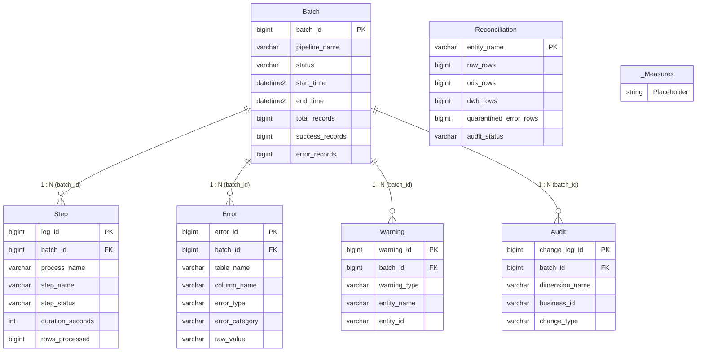

# DATA DICTIONARY – POWER BI PIPELINE MONITORING & OBSERVABILITY MODEL

**Mô hình**: QuickBite ETL Pipeline Monitoring & Observability  
**Nguồn dữ liệu (Database)**: `FoodDeliveryDW` (SQL Server `localhost\SQLEXPRESS`)  
**Tầng Semantic Serving**: Schema `bi` (6 Semantic Views)  
**Chế độ lưu trữ (Storage Mode)**: `Import` (Bộ nhớ Tabular / VertiPaq Engine)  
**File định dạng mô hình**: 
- TMDL: [`powerbi/pipeline_monitoring/tmdl/`](file:///c:/Users/PC/Downloads/food-delivery-etl-dwh/powerbi/pipeline_monitoring/tmdl/)
- BIM: [`powerbi/pipeline_monitoring/model.bim`](file:///c:/Users/PC/Downloads/food-delivery-etl-dwh/powerbi/pipeline_monitoring/model.bim)

---

## 1. SƠ ĐỒ MỐI QUAN HỆ (DATA MODEL ERD)



---

## 2. TỔNG QUAN CÁC BẢNG TRONG MÔ HÌNH

| Tên Bảng | Vai Trò Trong Model | Nguồn Dữ Liệu SQL | Số Cột | Số Dòng Hiện Tại | Khóa Chính (PK) / Khóa Ngoại (FK) |
| :--- | :--- | :--- | :---: | :---: | :--- |
| **`Batch`** | Dimension / Header | `bi.v_monitor_pipeline_overview` | 18 | 36 | **PK**: `batch_id` |
| **`Step`** | Fact (Execution Logs) | `bi.v_monitor_step_performance` | 17 | 33 | **PK**: `log_id`, **FK**: `batch_id` |
| **`Error`** | Fact (Quarantine Audit) | `bi.v_monitor_data_quality_errors` | 13 | 69,689 | **PK**: `error_id`, **FK**: `batch_id` |
| **`Warning`** | Fact (Anomaly Alerts) | `bi.v_monitor_warnings_anomalies` | 11 | 5,058 | **PK**: `warning_id`, **FK**: `batch_id` |
| **`Audit`** | Fact (SCD2 History) | `bi.v_monitor_scd2_audit` | 13 | 0 | **PK**: `change_log_id`, **FK**: `batch_id` |
| **`Reconciliation`** | Standalone Audit Scorecard | `bi.v_monitor_layer_reconciliation` | 10 | 8 | **PK**: `entity_name` (Không có FK) |
| **`_Measures`** | Measure Holding Table | Bảng tính toán (Calculated Table) | 1 (Hidden) | 14 Measures | Bảng chứa toàn bộ công thức DAX |

---

## 3. TỪ ĐIỂN DỮ LIỆU CHI TIẾT TỪNG BẢNG (DATA DICTIONARY)

### 3.1. Bảng `Batch` (Tổng quan các đợt chạy ETL)
* **Ý nghĩa**: Bảng trung tâm lưu trữ thông tin cấp mẻ (batch-level) của toàn bộ các lần chạy pipeline (Python, SSIS, T-SQL).
* **Nguồn**: `bi.v_monitor_pipeline_overview` ➔ `control.etl_batch`.

| Tên Cột | Kiểu Dữ Liệu | Nullable | Mô Tả & Nghiệp Vụ | Giá Trị Mẫu / Miền Giá Trị |
| :--- | :---: | :---: | :--- | :--- |
| **`batch_id`** | `Int64` | NO | Khóa chính định danh mẻ chạy | `1`, `27`, `34`, `36` |
| **`pipeline_name`** | `String` | NO | Tên pipeline thực thi | `'FoodDeliveryETL'`, `'CSV_to_RAW_Pipeline'` |
| **`source_system`** | `String` | NO | Nguồn dữ liệu đầu vào | `'CSV'`, `'QuickBite Ingestion Engine'` |
| **`source_file_count`** | `Int64` | NO | Số file nguồn CSV xử lý trong batch | `8`, `1` |
| **`start_time`** | `DateTime` | NO | Thời điểm bắt đầu chạy batch | `2026-10-16 01:57:19` |
| **`end_time`** | `DateTime` | YES | Thời điểm kết thúc batch (`NULL` nếu đang chạy) | `2026-10-16 01:57:19` |
| **`duration_seconds`** | `Int64` | YES | Thời gian chạy tính theo giây | `0`, `45`, `120` |
| **`duration_minutes`** | `Double` | YES | Thời gian chạy tính theo phút (làm tròn 2 số thập phân) | `0.0`, `0.75`, `2.0` |
| **`batch_status`** | `String` | NO | Trạng thái batch theo Constraint kiểm soát | `'SUCCESS'`, `'FAILED'`, `'RUNNING'`, `'PARTIAL'` |
| **`total_records`** | `Int64` | NO | Tổng số dòng dữ liệu batch tiếp nhận | `1000`, `1195593` |
| **`success_records`** | `Int64` | NO | Số dòng xử lý và nạp thành công | `990`, `1148133` |
| **`error_records`** | `Int64` | NO | Số dòng bị lỗi và chặn lại | `10`, `47460` |
| **`success_rate_pct`** | `Double` | YES | Tỷ lệ thành công (%): `(success / total) * 100` | `99.0`, `100.0`, `80.0` |
| **`error_rate_pct`** | `Double` | YES | Tỷ lệ lỗi (%): `(error / total) * 100` | `1.0`, `0.0`, `20.0` |
| **`is_latest_batch`** | `Boolean` | YES | Cờ đánh dấu mẻ chạy mới nhất trong hệ thống | `TRUE` (1), `FALSE` (0) |
| **`hours_since_run`** | `Int64` | YES | Số giờ đã trôi qua kể từ khi mẻ chạy bắt đầu | `8`, `24`, `48` |
| **`pipeline_health_status`**| `String` | NO | Phân loại trạng thái sức khỏe tự động | `'Healthy'`, `'Critical (Failed)'`, `'Running'` |
| **`created_at`** | `DateTime` | NO | Thời điểm ghi log vào hệ thống | `2026-10-16 01:57:19` |

---

### 3.2. Bảng `Step` (Hiệu năng chi tiết từng bước ETL)
* **Ý nghĩa**: Lưu trữ thời gian chạy và lưu lượng bản ghi của từng bước (step) và từng tiến trình (process) trong pipeline để phát hiện nút thắt cổ chai (bottlenecks).
* **Nguồn**: `bi.v_monitor_step_performance` ➔ `control.etl_log`.

| Tên Cột | Kiểu Dữ Liệu | Nullable | Mô Tả & Nghiệp Vụ | Giá Trị Mẫu / Miền Giá Trị |
| :--- | :---: | :---: | :--- | :--- |
| **`log_id`** | `Int64` | NO | Khóa chính của dòng log | `1`, `2`, `33` |
| **`batch_id`** | `Int64` | NO | Khóa ngoại tham chiếu `Batch[batch_id]` | `1` |
| **`pipeline_name`** | `String` | NO | Tên pipeline chứa bước này | `'FoodDeliveryETL'` |
| **`process_name`** | `String` | NO | Tên nhóm tiến trình nghiệp vụ | `'ODS_TO_DWH'`, `'DWH_MAINTENANCE'`, `'INGESTION'` |
| **`step_name`** | `String` | NO | Tên thủ tục / bước thực thi cụ thể | `'LOAD_FACT_DELIVERY_PERFORMANCE'`, `'INDEX_STATS_MAINTENANCE'` |
| **`start_time`** | `DateTime` | NO | Thời điểm bắt đầu bước | `2026-10-15 02:39:40` |
| **`end_time`** | `DateTime` | YES | Thời điểm kết thúc bước | `2026-10-15 02:39:43` |
| **`duration_seconds`** | `Int64` | YES | Thời lượng thực thi của bước (giây) | `3`, `10`, `1` |
| **`duration_minutes`** | `Double` | YES | Thời lượng thực thi của bước (phút) | `0.05`, `0.167` |
| **`step_status`** | `String` | NO | Trạng thái bước | `'SUCCESS'`, `'FAILED'`, `'RUNNING'` |
| **`rows_processed`** | `Int64` | NO | Số dòng bản ghi bước này nhận vào xử lý | `138054`, `68825`, `15` |
| **`rows_inserted`** | `Int64` | NO | Số dòng nạp thành công vào bảng đích | `138054`, `68825` |
| **`rows_rejected`** | `Int64` | NO | Số dòng bị từ chối / loại bỏ ở bước này | `0`, `36348` |
| **`rejection_rate_pct`**| `Double` | YES | Tỷ lệ từ chối (%): `(rejected / processed) * 100` | `0.0%`, `10.6%` |
| **`throughput_rows_per_sec`**| `Double` | YES | Tốc độ xử lý: `rows_processed / duration_seconds` | `46018`, `68825` (rows/s) |
| **`message`** | `String` | YES | Thông báo kỹ thuật hoặc chi tiết thực thi | `'Successfully loaded 138054 rows into dwh.fact_delivery_performance'` |
| **`created_at`** | `DateTime` | NO | Thời điểm tạo bản ghi log | `2026-10-15 02:39:40` |

---

### 3.3. Bảng `Error` (Kho cách ly dữ liệu lỗi chất lượng)
* **Ý nghĩa**: Bảng lưu trữ chi tiết từng dòng dữ liệu bị loại bỏ trong quá trình chuẩn hóa (RAW sang ODS) kèm lý do kỹ thuật và giá trị dữ liệu thô.
* **Nguồn**: `bi.v_monitor_data_quality_errors` ➔ `control.etl_error`.

| Tên Cột | Kiểu Dữ Liệu | Nullable | Mô Tả & Nghiệp Vụ | Giá Trị Mẫu / Phân Loại |
| :--- | :---: | :---: | :--- | :--- |
| **`error_id`** | `Int64` | NO | Khóa chính của bản ghi lỗi | `1`, `36348`, `69689` |
| **`batch_id`** | `Int64` | NO | Khóa ngoại tham chiếu `Batch[batch_id]` | `1` |
| **`pipeline_name`** | `String` | YES | Tên pipeline phát hiện lỗi | `'FoodDeliveryETL'` |
| **`batch_status`** | `String` | YES | Trạng thái batch tương ứng | `'SUCCESS'`, `'FAILED'` |
| **`table_name`** | `String` | NO | Tên bảng nguồn có bản ghi bị lỗi | `'raw_order_item'`, `'raw_delivery_performance'`, `'customer'` |
| **`column_name`** | `String` | NO | Tên cột bị vi phạm | `'order_id'`, `'actual_delivery_time_min'`, `'order_item'` |
| **`error_type`** | `String` | NO | Mã phân loại lỗi kỹ thuật | `'MASTER_DATA_NOT_FOUND'`, `'INVALID_FORMAT'`, `'FILE_VALIDATION_ERROR'` |
| **`error_category`** | `String` | NO | Nhóm lỗi nghiệp vụ chuẩn hóa cho BI | `'Referential Integrity (Orphan Record)'`, `'Data Type & Format Incompatibility'` |
| **`error_message`** | `String` | NO | Chi tiết mô tả lỗi từ pipeline | `'order_id value does not exists in reference master'` |
| **`raw_value`** | `String` | YES | Giá trị thô trong file CSV gây ra lỗi | `'ORD202501000003'`, `''` (Blank chuỗi rỗng) |
| **`source_file_name`** | `String` | YES | Tên file CSV nguồn phát sinh lỗi | `'order_item_20250930.csv'`, `'delivery_performance_20251030.csv'` |
| **`source_row_number`**| `Int64` | YES | Số thứ tự dòng trong file CSV nguồn | `1024`, `5512` |
| **`error_timestamp`** | `DateTime` | NO | Thời điểm phát hiện và ghi nhận lỗi | `2026-10-15 02:38:15` |

---

### 3.4. Bảng `Warning` (Cảnh báo bất thường & Orphan Non-fatal)
* **Ý nghĩa**: Lưu vết các bản ghi không vi phạm nghiêm trọng để bị chặn lại, nhưng có dấu hiệu bất thường về mặt logic vận hành (ví dụ: Khách hàng chưa từng phát sinh đơn hàng, đơn hàng thiếu tài xế gán tạm thời).
* **Nguồn**: `bi.v_monitor_warnings_anomalies` ➔ `control.etl_warning`.

| Tên Cột | Kiểu Dữ Liệu | Nullable | Mô Tả & Nghiệp Vụ | Giá Trị Mẫu |
| :--- | :---: | :---: | :--- | :--- |
| **`warning_id`** | `Int64` | NO | Khóa chính cảnh báo | `1`, `5058` |
| **`batch_id`** | `Int64` | NO | Khóa ngoại tham chiếu `Batch[batch_id]` | `1` |
| **`pipeline_name`** | `String` | YES | Tên pipeline phát sinh cảnh báo | `'FoodDeliveryETL'` |
| **`step_name`** | `String` | NO | Bước phát hiện cảnh báo | `'VALIDATE_CUSTOMER_ORPHANS'` |
| **`table_name`** | `String` | NO | Bảng liên quan | `'ods_customer'` |
| **`order_id`** | `String` | YES | Mã đơn hàng (nếu cảnh báo liên quan đơn hàng) | `NULL`, `'ORD202502000100'` |
| **`entity_name`** | `String` | NO | Tên thực thể | `'CUSTOMER'`, `'DELIVERY_PARTNER'` |
| **`entity_id`** | `String` | NO | Mã định danh thực thể cảnh báo | `'CUST_100234'` |
| **`warning_type`** | `String` | NO | Loại cảnh báo | `'ORPHAN_CUSTOMER_DETECTED'` |
| **`warning_message`** | `String` | NO | Nội dung chi tiết cảnh báo | `'Customer registered but has 0 transactions over 90 days'` |
| **`warning_timestamp`**| `DateTime` | NO | Thời điểm ghi nhận cảnh báo | `2026-10-15 02:38:50` |

---

### 3.5. Bảng `Reconciliation` (Đối soát dữ liệu toàn diện các tầng)
* **Ý nghĩa**: Bảng đối soát số lượng bản ghi giữa **RAW ➔ ODS ➔ DWH** cho cả 8 thực thể dữ liệu chính.
* **Nguồn**: `bi.v_monitor_layer_reconciliation`.

| Tên Cột | Kiểu Dữ Liệu | Nullable | Mô Tả & Nghiệp Vụ | Giá Trị Mẫu |
| :--- | :---: | :---: | :--- | :--- |
| **`entity_name`** | `String` | NO | Tên thực thể đối soát (Khóa chính bảng) | `'Order Item'`, `'Delivery Performance'`, `'Customer'` |
| **`raw_rows`** | `Int64` | YES | Tổng số dòng bản ghi tại tầng RAW | `342,994` (Order Item), `107,776` (Customer) |
| **`ods_rows`** | `Int64` | YES | Tổng số dòng bản ghi hợp lệ nạp vào ODS | `306,646` (Order Item), `107,776` (Customer) |
| **`dwh_rows`** | `Int64` | YES | Tổng số dòng nạp vào DWH (không tính Unknown Key -1) | `306,646` (Order Item), `107,776` (Customer) |
| **`raw_to_ods_variance`**| `Int64` | YES | Chênh lệch giữa RAW và ODS (`raw_rows - ods_rows`) | `36,348` (Khớp 100% với số dòng lỗi) |
| **`ods_to_dwh_variance`**| `Int64` | YES | Chênh lệch giữa ODS và DWH (`ods_rows - dwh_rows`) | `0` (100% ODS vào trọn vẹn DWH) |
| **`quarantined_error_rows`**| `Int64` | YES | Số dòng lỗi được cách ly tương ứng trong bảng Error | `36,348` (Khớp 100% với variance) |
| **`warning_rows`** | `Int64` | YES | Số cảnh báo liên quan đến thực thể này | `0`, `5057` |
| **`data_retention_rate_pct`**| `Double` | YES | Tỷ lệ dữ liệu sạch nạp vào DWH (%): `(dwh / raw) * 100` | `89.4%` (Order Item), `100.0%` (Customer) |
| **`audit_status`** | `String` | NO | Trạng thái kết luận kiểm toán tính toàn vẹn | `'RECONCILED (Valid Audit)'` |

---

### 3.6. Bảng `Audit` (Kiểm toán SCD Type 1 & Type 2)
* **Ý nghĩa**: Bảng lưu lịch sử thay đổi thuộc tính của các chiều theo thời gian (Slowly Changing Dimensions).
* **Nguồn**: `bi.v_monitor_scd2_audit` ➔ `control.dim_change_log`.

| Tên Cột | Kiểu Dữ Liệu | Nullable | Mô Tả |
| :--- | :---: | :---: | :--- |
| **`change_log_id`** | `Int64` | NO | Khóa chính bản ghi audit |
| **`batch_id`** | `Int64` | NO | Khóa ngoại tham chiếu `Batch[batch_id]` |
| **`pipeline_name`** | `String` | YES | Tên pipeline thực hiện update |
| **`dimension_name`** | `String` | NO | Tên bảng Dimension thay đổi (`dim_customer`, `dim_restaurant`...) |
| **`business_id`** | `String` | NO | Khóa nghiệp vụ tự nhiên (`customer_id`, `restaurant_id`) |
| **`surrogate_key_old`**| `Int64` | YES | Surrogate key bản ghi cũ trước khi cập nhật |
| **`surrogate_key_new`**| `Int64` | YES | Surrogate key bản ghi mới được sinh ra |
| **`change_type`** | `String` | NO | Loại thay đổi: `'SCD1_UPDATE'`, `'SCD2_INSERT'` |
| **`column_name`** | `String` | NO | Tên cột thuộc tính bị thay đổi giá trị |
| **`old_value`** | `String` | YES | Giá trị cũ trước khi thay đổi |
| **`new_value`** | `String` | YES | Giá trị mới sau khi cập nhật |
| **`effective_date`** | `DateTime` | NO | Ngày có hiệu lực của thay đổi |
| **`logged_at`** | `DateTime` | NO | Thời điểm ghi log thay đổi vào hệ thống |

---

## 4. CHI TIẾT CÁC MỐI QUAN HỆ TRONG MÔ HÌNH (RELATIONSHIPS)

| Tên Mối Quan Hệ | Bảng Nguồn (From Table - Many) | Cột Nguồn | Bảng Đích (To Table - One) | Cột Đích | Hướng Lọc (Cross Filter) | Trạng Thái |
| :--- | :--- | :--- | :--- | :--- | :---: | :---: |
| **`Rel_Batch_StepPerformance`** | `Step` | `batch_id` | `Batch` | `batch_id` | `OneDirection` (Single) | Active ✅ |
| **`Rel_Batch_DataQualityErrors`**| `Error` | `batch_id` | `Batch` | `batch_id` | `OneDirection` (Single) | Active ✅ |
| **`Rel_Batch_WarningsAnomalies`**| `Warning` | `batch_id` | `Batch` | `batch_id` | `OneDirection` (Single) | Active ✅ |
| **`Rel_Batch_Scd2Audit`** | `Audit` | `batch_id` | `Batch` | `batch_id` | `OneDirection` (Single) | Active ✅ |

---

## 5. THƯ VIỆN MEASURES (DAX FORMULAS DICTIONARY)

Toàn bộ các measures được lưu trữ tập trung tại bảng `_Measures`:

### Thư mục: `01. Pipeline Status & Health`
1. **`Latest Batch ID`**
   * **Mô tả**: Lấy mã batch của lần chạy gần đây nhất trên toàn hệ thống.
   * **Cú pháp DAX**:
     ```dax
     CALCULATE(MAX('Batch'[batch_id]), ALL('Batch'))
     ```
   * **Kiểu dữ liệu**: `Whole Number` | **Format**: `#,##0`

2. **`Latest Batch Status`**
   * **Mô tả**: Trạng thái thực thi của mẻ chạy gần nhất (`SUCCESS`, `FAILED`, `RUNNING`).
   * **Cú pháp DAX**:
     ```dax
     CALCULATE(
         SELECTEDVALUE('Batch'[batch_status]),
         FILTER(ALL('Batch'), 'Batch'[batch_id] = [Latest Batch ID])
     )
     ```
   * **Kiểu dữ liệu**: `Text`

3. **`Pipeline Health KPI`**
   * **Mô tả**: Huy hiệu sức khỏe trực quan có màu sắc và icon phục vụ hiển thị lên KPI Card chính.
   * **Cú pháp DAX**:
     ```dax
     SWITCH(
         [Latest Batch Status],
         "SUCCESS", "🟢 Healthy",
         "RUNNING", "🔵 In Progress",
         "PARTIAL", "🟡 Degraded",
         "FAILED",  "🔴 Critical",
         "⚪ Unknown"
     )
     ```
   * **Kiểu dữ liệu**: `Text`

4. **`Hours Since Last Run`**
   * **Mô tả**: Số giờ đã trôi qua kể từ thời điểm mẻ chạy gần nhất bắt đầu nạp dữ liệu.
   * **Cú pháp DAX**:
     ```dax
     VAR _LastStartTime = 
         CALCULATE(
             MAX('Batch'[start_time]),
             FILTER(ALL('Batch'), 'Batch'[batch_id] = [Latest Batch ID])
         )
     RETURN
         IF(NOT ISBLANK(_LastStartTime), DATEDIFF(_LastStartTime, NOW(), HOUR), BLANK())
     ```
   * **Kiểu dữ liệu**: `Whole Number` | **Format**: `#,##0`

5. **`Data Freshness Status`**
   * **Mô tả**: Đánh giá tính mới của dữ liệu theo cam kết SLA (< 24 giờ).
   * **Cú pháp DAX**:
     ```dax
     VAR _Hours = [Hours Since Last Run]
     RETURN
         SWITCH(
             TRUE(),
             ISBLANK(_Hours), "⚪ Unknown",
             _Hours <= 24, "🟢 Fresh (< 24h)",
             _Hours <= 36, "🟡 Warning (24h - 36h)",
             "🔴 Stale (> 36h)"
         )
     ```
   * **Kiểu dữ liệu**: `Text`

---

### Thư mục: `02. Execution & Throughput`
6. **`Total Batches Executed`**
   * **Mô tả**: Tổng số lần pipeline đã thực thi được ghi nhận trong `control.etl_batch`.
   * **Cú pháp DAX**:
     ```dax
     COUNTROWS('Batch')
     ```
   * **Kiểu dữ liệu**: `Whole Number` | **Format**: `#,##0`

7. **`Avg Success Rate Pct`**
   * **Mô tả**: Tỷ lệ nạp thành công trung bình của các mẻ chạy.
   * **Cú pháp DAX**:
     ```dax
     AVERAGE('Batch'[success_rate_pct])
     ```
   * **Kiểu dữ liệu**: `Decimal Number` | **Format**: `0.00`

8. **`Avg Batch Duration Min`**
   * **Mô tả**: Thời gian thực thi trung bình (phút) của các batch hoàn thành thành công.
   * **Cú pháp DAX**:
     ```dax
     AVERAGEX(
         FILTER('Batch', 'Batch'[batch_status] = "SUCCESS"),
         'Batch'[duration_minutes]
     )
     ```
   * **Kiểu dữ liệu**: `Decimal Number` | **Format**: `#,##0.0`

9. **`Avg Step Duration Sec`**
   * **Mô tả**: Thời lượng trung bình (giây) của từng bước thực thi trong pipeline.
   * **Cú pháp DAX**:
     ```dax
     AVERAGE('Step'[duration_seconds])
     ```
   * **Kiểu dữ liệu**: `Decimal Number` | **Format**: `#,##0.0`

---

### Thư mục: `03. Data Quality & Errors`
10. **`Total Quarantined Errors`**
    * **Mô tả**: Tổng số dòng dữ liệu vi phạm chất lượng đang được cách ly trong bảng `Error`.
    * **Cú pháp DAX**:
      ```dax
      COUNTROWS('Error')
      ```
    * **Kiểu dữ liệu**: `Whole Number` | **Format**: `#,##0`

11. **`Total Operational Warnings`**
    * **Mô tả**: Tổng số cảnh báo bất thường vận hành ghi nhận trong bảng `Warning`.
    * **Cú pháp DAX**:
      ```dax
      COUNTROWS('Warning')
      ```
    * **Kiểu dữ liệu**: `Whole Number` | **Format**: `#,##0`

---

### Thư mục: `04. Layer Reconciliation`
12. **`Total Records Ingested RAW`**
    * **Mô tả**: Tổng sản lượng bản ghi đã tiếp nhận ở tầng RAW trên cả 8 bảng dữ liệu.
    * **Cú pháp DAX**:
      ```dax
      SUM('Reconciliation'[raw_rows])
      ```
    * **Kiểu dữ liệu**: `Whole Number` | **Format**: `#,##0`

13. **`Total Records Loaded DWH`**
    * **Mô tả**: Tổng sản lượng bản ghi đạt chuẩn được nạp vào tầng DWH.
    * **Cú pháp DAX**:
      ```dax
      SUM('Reconciliation'[dwh_rows])
      ```
    * **Kiểu dữ liệu**: `Whole Number` | **Format**: `#,##0`

14. **`Overall Data Retention Rate Pct`**
    * **Mô tả**: Tỷ lệ lưu giữ dữ liệu toàn hệ thống: `(Tổng DWH / Tổng RAW) * 100`.
    * **Cú pháp DAX**:
      ```dax
      DIVIDE([Total Records Loaded DWH], [Total Records Ingested RAW], 0) * 100
      ```
    * **Kiểu dữ liệu**: `Decimal Number` | **Format**: `0.00`
