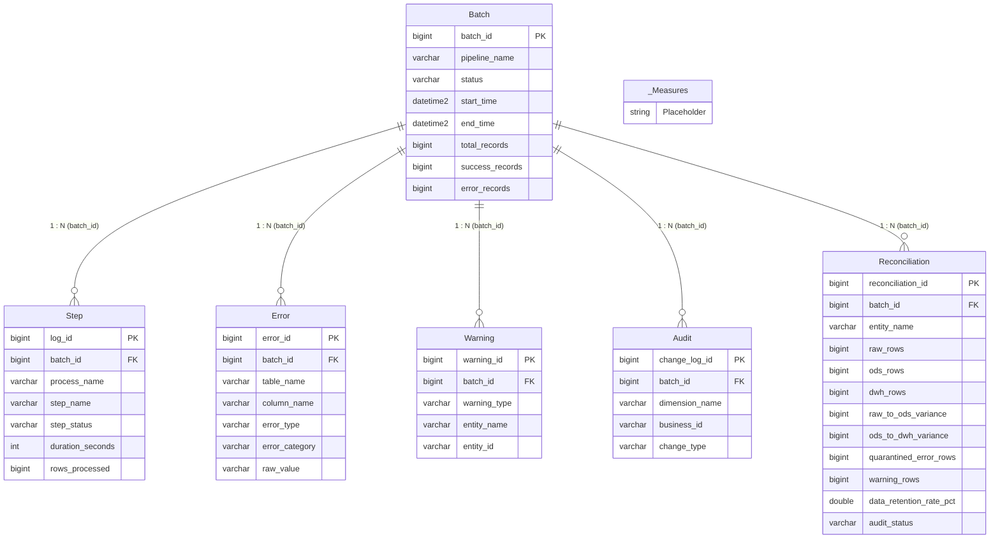

# DATA DICTIONARY – POWER BI PIPELINE MONITORING & OBSERVABILITY MODEL

**Model Name**: QuickBite ETL Pipeline Monitoring & Observability  
**Database**: `FoodDeliveryDW` (SQL Server `localhost\SQLEXPRESS`)  
**Semantic Serving Layer**: Schema `bi` (6 Semantic Views)  
**Storage Mode**: `Import` (Tabular / VertiPaq In-Memory Engine)  
**Model Definition Files**: 
- TMDL: [`powerbi/pipeline_monitoring/tmdl/`](file:///c:/Users/PC/Downloads/food-delivery-etl-dwh/powerbi/pipeline_monitoring/tmdl/)
- BIM: [`powerbi/pipeline_monitoring/model.bim`](file:///c:/Users/PC/Downloads/food-delivery-etl-dwh/powerbi/pipeline_monitoring/model.bim)

---

## 1. DATA MODEL RELATIONSHIPS (ERD)

---

## 2. DATASET & TABLE OVERVIEW

| Table Name | Model Role | SQL Data Source | Columns | Current Rows | Key Mapping (PK / FK) |
| :--- | :--- | :--- | :---: | :---: | :--- |
| **`Batch`** | Dimension / Header | `bi.v_monitor_pipeline_overview` | 18 | 9 | **PK**: `batch_id` |
| **`Step`** | Fact (Execution Logs) | `bi.v_monitor_step_performance` | 17 | 198 | **PK**: `log_id`, **FK**: `batch_id` |
| **`Error`** | Fact (Quarantine Audit) | `bi.v_monitor_data_quality_errors` | 13 | 12,964 | **PK**: `error_id`, **FK**: `batch_id` |
| **`Warning`** | Fact (Anomaly Alerts) | `bi.v_monitor_warnings_anomalies` | 11 | 5,096 | **PK**: `warning_id`, **FK**: `batch_id` |
| **`Audit`** | Fact (SCD2 History) | `bi.v_monitor_scd2_audit` | 13 | 1,975 | **PK**: `change_log_id`, **FK**: `batch_id` |
| **`Reconciliation`** | Fact (Layer Audit Scorecard) | `bi.v_monitor_layer_reconciliation` | 12 | 72 | **PK**: `reconciliation_id`, **FK**: `batch_id` |
| **`_Measures`** | Measure Holding Table | Calculated Table | 1 (Hidden) | 69 Measures | Central DAX repository (6 Display Folders) |

---

## 3. DETAILED TABLE SCHEMAS

### 3.1. `Batch` Table (ETL Execution Overview)
* **Purpose**: Central table storing batch-level execution metadata for all ETL pipeline runs (Python, SSIS, T-SQL).
* **Source**: `bi.v_monitor_pipeline_overview` ➔ `control.etl_batch`.

| Column Name | Data Type | Nullable | Description & Business Rules | Sample / Domain Values |
| :--- | :---: | :---: | :--- | :--- |
| **`batch_id`** | `Int64` | NO | Unique execution batch identifier (Primary Key) | `1`, `27`, `34`, `36` |
| **`pipeline_name`** | `String` | NO | Name of executed pipeline | `'FoodDeliveryETL'`, `'CSV_to_RAW_Pipeline'` |
| **`source_system`** | `String` | NO | Data ingestion source identifier | `'QuickBite_File_Ingestion'`, `'QuickBite Ingestion Engine'` |
| **`source_file_count`** | `Int64` | NO | Number of source CSV files processed in this batch | `8`, `1` |
| **`start_time`** | `DateTime` | NO | Batch start timestamp | `2026-10-16 01:57:19` |
| **`end_time`** | `DateTime` | YES | Batch completion timestamp (`NULL` if still running) | `2026-10-16 01:57:19` |
| **`duration_seconds`** | `Int64` | YES | Batch elapsed runtime in seconds | `0`, `45`, `120` |
| **`duration_minutes`** | `Double` | YES | Batch elapsed runtime in minutes (2 decimal places) | `0.0`, `0.75`, `2.0` |
| **`batch_status`** | `String` | NO | Execution status constrained by control table | `'SUCCESS'`, `'FAILED'`, `'RUNNING'`, `'PARTIAL'` |
| **`total_records`** | `Int64` | NO | Total input records ingested | `1000`, `1195593` |
| **`success_records`** | `Int64` | NO | Total valid records successfully processed and loaded | `990`, `1148133` |
| **`error_records`** | `Int64` | NO | Total invalid/rejected records quarantined | `10`, `47460` |
| **`success_rate_pct`** | `Double` | YES | Success percentage: `(success_records / total_records) * 100` | `99.0`, `100.0`, `80.0` |
| **`error_rate_pct`** | `Double` | YES | Error percentage: `(error_records / total_records) * 100` | `1.0`, `0.0`, `20.0` |
| **`is_latest_batch`** | `Boolean` | YES | Flag indicating the most recent batch execution | `TRUE` (1), `FALSE` (0) |
| **`hours_since_run`** | `Int64` | YES | Elapsed hours since batch execution began | `8`, `24`, `48` |
| **`pipeline_health_status`**| `String` | NO | Automated health classification category | `'Healthy'`, `'Critical (Failed)'`, `'Running'` |
| **`created_at`** | `DateTime` | NO | System timestamp when batch was registered | `2026-10-16 01:57:19` |

---

### 3.2. `Step` Table (Detailed Step Performance & Latency)
* **Purpose**: Records individual task and process durations and processed volumes to pinpoint latency bottlenecks.
* **Source**: `bi.v_monitor_step_performance` ➔ `control.etl_log`.

| Column Name | Data Type | Nullable | Description & Business Rules | Sample / Domain Values |
| :--- | :---: | :---: | :--- | :--- |
| **`log_id`** | `Int64` | NO | Unique step execution log record identifier (PK) | `1`, `2`, `33` |
| **`batch_id`** | `Int64` | NO | Foreign Key referencing `Batch[batch_id]` | `1` |
| **`pipeline_name`** | `String` | NO | Name of pipeline containing this step | `'FoodDeliveryETL'` |
| **`process_name`** | `String` | NO | Logical business process stage | `'ODS_TO_DWH'`, `'DWH_MAINTENANCE'`, `'INGESTION'` |
| **`step_name`** | `String` | NO | Specific transformation step or stored procedure | `'LOAD_FACT_DELIVERY_PERFORMANCE'`, `'INDEX_STATS_MAINTENANCE'` |
| **`start_time`** | `DateTime` | NO | Step execution start timestamp | `2026-10-15 02:39:40` |
| **`end_time`** | `DateTime` | YES | Step execution completion timestamp | `2026-10-15 02:39:43` |
| **`duration_seconds`** | `Int64` | YES | Step duration in seconds | `3`, `10`, `1` |
| **`duration_minutes`** | `Double` | YES | Step duration in minutes | `0.05`, `0.167` |
| **`step_status`** | `String` | NO | Step execution outcome | `'SUCCESS'`, `'FAILED'`, `'RUNNING'` |
| **`rows_processed`** | `Int64` | NO | Input row count ingested by this step | `138054`, `68825`, `15` |
| **`rows_inserted`** | `Int64` | NO | Records successfully loaded into target table | `138054`, `68825` |
| **`rows_rejected`** | `Int64` | NO | Records rejected or dropped during transformation | `0`, `36348` |
| **`rejection_rate_pct`**| `Double` | YES | Step rejection rate: `(rows_rejected / rows_processed) * 100` | `0.0%`, `10.6%` |
| **`throughput_rows_per_sec`**| `Double` | YES | Processing throughput: `rows_processed / duration_seconds` | `46018`, `68825` (rows/s) |
| **`message`** | `String` | YES | Technical execution details or error message | `'Successfully loaded 138054 rows into dwh.fact_delivery_performance'` |
| **`created_at`** | `DateTime` | NO | Log timestamp | `2026-10-15 02:39:40` |

---

### 3.3. `Error` Table (Quarantined Data Quality Audit)
* **Purpose**: Quarantined records rejected during data quality validation (RAW to ODS) with technical error codes and raw values.
* **Source**: `bi.v_monitor_data_quality_errors` ➔ `control.etl_error`.

| Column Name | Data Type | Nullable | Description & Business Rules | Sample / Domain Values |
| :--- | :---: | :---: | :--- | :--- |
| **`error_id`** | `Int64` | NO | Unique quarantined error record identifier (PK) | `1`, `36348`, `69689` |
| **`batch_id`** | `Int64` | NO | Foreign Key referencing `Batch[batch_id]` | `1` |
| **`pipeline_name`** | `String` | YES | Name of pipeline capturing the error | `'FoodDeliveryETL'` |
| **`batch_status`** | `String` | YES | Status of corresponding batch | `'SUCCESS'`, `'FAILED'` |
| **`table_name`** | `String` | NO | Source entity table name | `'raw_order_item'`, `'raw_delivery_performance'`, `'customer'` |
| **`column_name`** | `String` | NO | Field name violating DQ rule | `'order_id'`, `'actual_delivery_time_min'`, `'order_item'` |
| **`error_type`** | `String` | NO | Technical error classification code | `'MASTER_DATA_NOT_FOUND'`, `'INVALID_FORMAT'`, `'FILE_VALIDATION_ERROR'` |
| **`error_category`** | `String` | NO | Standardized business DQ category | `'Referential Integrity (Orphan Record)'`, `'Data Type & Format Incompatibility'` |
| **`error_message`** | `String` | NO | Diagnostic description of DQ violation | `'order_id value does not exists in reference master'` |
| **`raw_value`** | `String` | YES | Unprocessed string literal causing validation failure | `'ORD202501000003'`, `''` (Blank / empty string) |
| **`source_file_name`** | `String` | YES | Source CSV file containing the defect | `'order_item_20250930.csv'`, `'delivery_performance_20251030.csv'` |
| **`source_row_number`**| `Int64` | YES | Exact row index in source CSV file | `1024`, `5512` |
| **`error_timestamp`** | `DateTime` | NO | Detection timestamp | `2026-10-15 02:38:15` |

---

### 3.4. `Warning` Table (Operational Warnings & Orphan Alerts)
* **Purpose**: Audit records that pass staging validation but exhibit non-fatal business anomalies (e.g., active customers without orders for 90+ days).
* **Source**: `bi.v_monitor_warnings_anomalies` ➔ `control.etl_warning`.

| Column Name | Data Type | Nullable | Description & Business Rules | Sample / Domain Values |
| :--- | :---: | :---: | :--- | :--- |
| **`warning_id`** | `Int64` | NO | Unique operational warning identifier (PK) | `1`, `5058` |
| **`batch_id`** | `Int64` | NO | Foreign Key referencing `Batch[batch_id]` | `1` |
| **`pipeline_name`** | `String` | YES | Name of pipeline raising warning | `'FoodDeliveryETL'` |
| **`step_name`** | `String` | NO | Verification step triggering the alert | `'VALIDATE_CUSTOMER_ORPHANS'` |
| **`table_name`** | `String` | NO | Associated entity table | `'ods_customer'` |
| **`order_id`** | `String` | YES | Relevant order identifier (if applicable) | `NULL`, `'ORD202502000100'` |
| **`entity_name`** | `String` | NO | High-level entity type | `'CUSTOMER'`, `'DELIVERY_PARTNER'` |
| **`entity_id`** | `String` | NO | Business identifier of flagged entity | `'CUST_100234'` |
| **`warning_type`** | `String` | NO | Warning classification code | `'ORPHAN_CUSTOMER_DETECTED'` |
| **`warning_message`** | `String` | NO | Diagnostic alert description | `'Customer registered but has 0 transactions over 90 days'` |
| **`warning_timestamp`**| `DateTime` | NO | Detection timestamp | `2026-10-15 02:38:50` |

---

### 3.5. `Reconciliation` Table (Cross-Layer Reconciliation by Batch)
* **Purpose**: Layer-by-layer balance scorecard comparing **RAW ➔ ODS ➔ DWH** record volumes for all 8 core entities per `batch_id`.
* **Source**: `bi.v_monitor_layer_reconciliation`.

> [!NOTE]
> **Primary Key Architecture in Power BI**:
> Because the `Reconciliation` view aggregates row counts by batch across 8 entities, `entity_name` repeats for every batch. An auto-incrementing integer **`reconciliation_id`** (`ROW_NUMBER()`) serves as the Primary Key, while **`batch_id`** acts as Foreign Key to **`Batch[batch_id]`** (1:N relationship).

| Column Name | Data Type | Nullable | Description & Business Rules | Sample / Domain Values |
| :--- | :---: | :---: | :--- | :--- |
| **`reconciliation_id`** | `Int64` | NO | Surrogate integer identifier (`ROW_NUMBER`) for Power BI (PK) | `1`, `2`, `72` |
| **`batch_id`** | `Int64` | NO | Foreign Key referencing `Batch[batch_id]` (1:N Relationship) | `1`, `9`, `36` |
| **`entity_name`** | `String` | NO | Data entity name (Customer, Restaurant, Orders, etc.) | `'Order Item'`, `'Delivery Performance'`, `'Customer'` |
| **`raw_rows`** | `Int64` | YES | Ingested physical rows at RAW layer for this batch | `48,965` (Batch 1 Order Item), `23,539` (Order) |
| **`ods_rows`** | `Int64` | YES | Validated rows staged into ODS | `48,965` (Batch 1 Order Item), `22,076` (Delivery Performance) |
| **`dwh_rows`** | `Int64` | YES | Rows loaded into DWH (excluding technical Unknown Key `-1`) | `48,965` (Order Item), `22,076` (Delivery Performance) |
| **`raw_to_ods_variance`**| `Int64` | YES | Variance between RAW and ODS (`raw_rows - ods_rows`) | `1,463` (Matches Batch 1 Quarantined Errors 100%) |
| **`ods_to_dwh_variance`**| `Int64` | YES | Variance between ODS and DWH (`ods_rows - dwh_rows`) | `-1,958` (Reflects SCD2 historical version expansions) |
| **`quarantined_error_rows`**| `Int64` | YES | Quarantined defect rows captured in Error table | `1,463` (Matches data quality rejections) |
| **`warning_rows`** | `Int64` | YES | Operational warning count associated with entity in batch | `0`, `453` |
| **`data_retention_rate_pct`**| `Double` | YES | Data retention percentage: `(dwh_rows / raw_rows) * 100` | `88.2%` (Delivery Perf Batch 9), `100.0%` (Order) |
| **`audit_status`** | `String` | NO | Audit reconciliation status flag | `'RECONCILED (Valid Audit)'` |

---

### 3.6. `Audit` Table (SCD Type 1 & Type 2 Dimension History)
* **Purpose**: Audit log tracking attribute changes over time across dimensions (Slowly Changing Dimensions).
* **Source**: `bi.v_monitor_scd2_audit` ➔ `control.dim_change_log`.

| Column Name | Data Type | Nullable | Description & Business Rules |
| :--- | :---: | :---: | :--- |
| **`change_log_id`** | `Int64` | NO | Unique dimension audit log record identifier (PK) |
| **`batch_id`** | `Int64` | NO | Foreign Key referencing `Batch[batch_id]` |
| **`pipeline_name`** | `String` | YES | Name of pipeline performing update |
| **`dimension_name`** | `String` | NO | Dimension table name updated (`dim_customer`, `dim_restaurant`...) |
| **`business_id`** | `String` | NO | Natural business identifier (`customer_id`, `restaurant_id`) |
| **`surrogate_key_old`**| `Int64` | YES | Previous surrogate key prior to update |
| **`surrogate_key_new`**| `Int64` | YES | New active surrogate key generated |
| **`change_type`** | `String` | NO | Update category: `'SCD1_UPDATE'`, `'SCD2_INSERT'` |
| **`column_name`** | `String` | NO | Specific attribute/column changed |
| **`old_value`** | `String` | YES | Previous attribute value |
| **`new_value`** | `String` | YES | Updated attribute value |
| **`effective_date`** | `DateTime` | NO | Effective start timestamp of version |
| **`logged_at`** | `DateTime` | NO | Log insertion timestamp |

---

## 4. MODEL RELATIONSHIPS SPECIFICATION

| Relationship Identifier | From Table (Many) | Foreign Key Column | To Table (One) | Primary Key Column | Filter Direction | State |
| :--- | :--- | :--- | :--- | :--- | :---: | :---: |
| **`Rel_Batch_StepPerformance`** | `Step` | `batch_id` | `Batch` | `batch_id` | `OneDirection` (Single) | Active ✅ |
| **`Rel_Batch_DataQualityErrors`**| `Error` | `batch_id` | `Batch` | `batch_id` | `OneDirection` (Single) | Active ✅ |
| **`Rel_Batch_WarningsAnomalies`**| `Warning` | `batch_id` | `Batch` | `batch_id` | `OneDirection` (Single) | Active ✅ |
| **`Rel_Batch_Scd2Audit`** | `Audit` | `batch_id` | `Batch` | `batch_id` | `OneDirection` (Single) | Active ✅ |
| **`Rel_Batch_LayerReconciliation`**| `Reconciliation` | `batch_id` | `Batch` | `batch_id` | `OneDirection` (Single) | Active ✅ |

---

## 5. DAX MEASURE LIBRARY (69 STANDARDIZED MEASURES)

All measures are organized into **6 standardized display folders** inside the `_Measures` table (complete source code available in [`powerbi/pipeline_monitoring/tmdl/tables/_Measures.tmdl`](file:///c:/Users/PC/Downloads/food-delivery-etl-dwh/powerbi/pipeline_monitoring/tmdl/tables/_Measures.tmdl)):

### 5.1. Folder: `01. Pipeline Status & Health` (6 Measures)
| Measure Name | Visual Location & Role | Core DAX Expression |
| :--- | :--- | :--- |
| **`Latest Batch ID`** | Global underlying measure retrieving latest batch ID | `CALCULATE(MAX('Batch'[batch_id]), ALL('Batch'))` |
| **`Latest Batch ID Label`** | Callout Card 1 – Page 1 (`Batch #9`) | `"Batch #" & FORMAT(_BatchID, "#,##0")` |
| **`Latest Batch Status`** | Status string of latest batch (`SUCCESS`, `PARTIAL`, `FAILED`, `RUNNING`) | `CALCULATE(SELECTEDVALUE('Batch'[batch_status]), FILTER(ALL('Batch'), 'Batch'[batch_id] = [Latest Batch ID]))` |
| **`Hours Since Last Run`** | Value pointer for SLA Gauge – Page 1 | Elapsed hours since latest execution run started |
| **`SLA Target Hours`** | Target SLA threshold on SLA Gauge (`24h`) | `24` |
| **`SLA Max Hours`** | Upper scale limit on SLA Gauge (`48h`) | `48` |

---

### 5.2. Folder: `02. Execution & Throughput` (12 Measures)
| Measure Name | Visual Location & Role | Core DAX Expression |
| :--- | :--- | :--- |
| **`Latest Batch Duration`** | Callout Card 2 – Page 1 (`12s` / `42s`) | Dynamic formatting `Xs` or `Xm Ys` from `Batch[duration_seconds]` |
| **`Batch Duration Sec`** | Secondary Line Y-Axis on Combo Chart – Page 1 | `COALESCE(SUM('Batch'[duration_seconds]), 0)` |
| **`Batch Total Records`** | Primary Column Y-Axis on Combo Chart – Page 1 | `COALESCE(SUM('Batch'[total_records]), 0)` |
| **`Total Steps Label`** | Callout Card 1 – Page 2 (`198 Steps`) | `FORMAT(COUNTROWS('Step'), "#,##0") & " Steps"` |
| **`Total Process Stages Label`** | Callout Card 2 – Page 2 (`6 Stages`) | `DISTINCTCOUNT('Step'[process_name])` with suffix `" Stage(s)"` |
| **`Total Step Duration Sec`** | X-Axis on `Top Execution Time Steps` – Page 2 | `COALESCE(SUM('Step'[duration_seconds]), 0)` |
| **`Total Step Duration Label`** | Callout Card 3 – Page 2 (`2m 40s`) | Formats `[Total Step Duration Sec]` into `Xs` / `Xm Ys` |
| **`Total Step Rows Processed`** | Callout Card 4 – Page 2 (`4,713,492`) | `COALESCE(SUM('Step'[rows_processed]), 0)` |
| **`Total Step Rows Inserted`** | Helper measure calculating yield rate | `COALESCE(SUM('Step'[rows_inserted]), 0)` |
| **`Total Step Rows Rejected`** | Callout Card 5 – Page 2 (`12,492`) | `COALESCE(SUM('Step'[rows_rejected]), 0)` |
| **`Step Rejection Rate Pct`** | Step-level rejection percentage (`0.27%`) | `DIVIDE([Total Step Rows Rejected], [Total Step Rows Processed], 0)` |
| **`Step Throughput (Rows/Sec)`** | X-Axis on `Step Throughput & Velocity` – Page 2 | `COALESCE(AVERAGE('Step'[throughput_rows_per_sec]), 0)` |

---

### 5.3. Folder: `03. Data Quality & Errors` (7 Measures)
| Measure Name | Visual Location & Role | Core DAX Expression |
| :--- | :--- | :--- |
| **`Total Quarantined Errors`** | Callout Card 4 (Page 1), Card 1 & Error charts (Page 3) (`12,964`) | `COUNTROWS('Error')` |
| **`True Data Defects`** | Callout Card 2 – Page 3 (`1,852` true defects excluding cancelled orders) | `CALCULATE(COUNTROWS('Error'), 'Error'[error_type] <> "EXCLUDED_ORDER_CANCELLED") + 0` |
| **`Affected Files Label`** | Callout Card 3 – Page 3 (`36 Files`) | `DISTINCTCOUNT('Error'[source_file_name])` with suffix `" File(s)"` |
| **`Violated Columns Label`** | Callout Card 4 – Page 3 (`12 Columns`) | `DISTINCTCOUNT('Error'[column_name])` with suffix `" Column(s)"` |
| **`Total Operational Warnings`** | Callout Card 5 (Page 1 & 3), Warning chart (`5,096`) | `COUNTROWS('Warning')` |
| **`Quarantined Error Rate Pct`** | Secondary Line Y-Axis on `Errors & Rejection Rate by Batch` – Page 3 | `DIVIDE([Total Quarantined Errors], [Total Records Ingested RAW], 0)` (with `TREATAS` batch bridge) |
| **`Operational Warning Rate Pct`** | Secondary Line Y-Axis on `Warnings & Anomaly Rate by Batch` – Page 3 | `DIVIDE([Total Operational Warnings], [Total Records Staged ODS], 0)` (with `TREATAS` batch bridge) |

---

### 5.4. Folder: `04. Layer Reconciliation` (9 Measures)
| Measure Name | Visual Location & Role | Core DAX Expression |
| :--- | :--- | :--- |
| **`Reconciliation Checks Label`** | Callout Card 1 – Page 4 (`72 Checks`) | `COUNTROWS('Reconciliation')` with suffix `" Check(s)"` |
| **`Total Records Ingested RAW`** | `RAW Ingested` Column – Matrix Page 4 (`1,161,911`) | `SUM('Reconciliation'[raw_rows])` |
| **`Total Records Staged ODS`** | Callout Card 2 & `ODS Staged` Column – Page 4 (`1,147,457`) | `COALESCE(SUM('Reconciliation'[ods_rows]), 0)` |
| **`Total Records Loaded DWH`** | Callout Card 3 (Page 1 & 4) & `DWH Loaded` Column (`1,149,415`) | `SUM('Reconciliation'[dwh_rows])` |
| **`Total RAW to ODS Variance`** | `RAW-ODS Variance` Column – Matrix Page 4 (`14,454`) | `COALESCE(SUM('Reconciliation'[raw_to_ods_variance]), 0)` |
| **`Total ODS to DWH Variance`** | `ODS-DWH Variance` Column – Matrix Page 4 (`-1,958`) | `COALESCE(SUM('Reconciliation'[ods_to_dwh_variance]), 0)` |
| **`Total Reconciliation Errors`** | `Quarantined Errors` Column – Matrix Page 4 (`12,492`) | `COALESCE(SUM('Reconciliation'[quarantined_error_rows]), 0)` |
| **`Overall Data Retention Rate Pct`**| Callout Card 4 & `Retention Rate` Column – Page 4 (`98.92%`) | `DIVIDE([Total Records Loaded DWH], [Total Records Ingested RAW], 0)` |
| **`Total Dimension Changes`** | Callout Card 5 & `Dimension Historical Changes` Chart – Page 4 (`1,975`) | `COUNTROWS('Audit') + 0` |

---

### 5.5. Folder: `05. Formatting & Colors` (6 Measures)
| Measure Name | Target Visual & Application | Dynamic Hex Rules |
| :--- | :--- | :--- |
| **`Batch Status Color`** | Batch status indicator in Combo Chart & Grid (Page 1) | `SUCCESS`: `#009E46` \| `FAILED`: `#C40C0C` \| `RUNNING`: `#D97706` \| Default: `#64748B` |
| **`SLA Status Color`** | Pointer color on SLA Gauge (Page 1) | `≤ 24h`: `#009E46` \| `24–36h`: `#D97706` \| `> 36h`: `#C40C0C` |
| **`Health Status Color`** | Overall pipeline health indicator | `SUCCESS`: `#009E46` \| `FAILED`: `#C40C0C` \| `RUNNING`: `#0F2C67` \| `PARTIAL`: `#D97706` |
| **`Step Status Color`** | Step status column in Grid (Page 2) | `SUCCESS`: `#009E46` \| `FAILED`: `#C40C0C` \| `RUNNING`: `#D97706` \| `PARTIAL`: `#64748B` |
| **`Step Rejection Color`** | Rejected rows column in Grid (Page 2) | `> 0`: `#C40C0C` (Red) \| `= 0`: `#009E46` (Green) |
| **`Audit Status Color`** | Audit status column in Reconciliation Matrix (Page 4) | Contains `"RECONCILED"`: `#009E46` (Green) \| `"VARIANCE DETECTED"`: `#C40C0C` (Red) |

---

### 5.6. Folder: `06. Card Subtexts` (20 Measures — Dynamic KPI Subtitles Across 4 Pages)
* **Page 1 (5 Subtexts)**: `Latest Batch Subtext`, `Batch Duration Subtext`, `Records to DWH Subtext`, `Quarantined Errors Subtext`, `Operational Warnings Subtext`.
* **Page 2 (5 Subtexts)**: `Step Execution Subtext`, `Process Stages Subtext`, `Step Duration Subtext`, `Step Rows Subtext`, `Step Rejected Subtext`.
* **Page 3 (5 Subtexts)**: `Error Drilldown Subtext`, `Data Defects Subtext`, `Affected Files Subtext`, `Violated Columns Subtext`, `Warning Drilldown Subtext`.
* **Page 4 (5 Subtexts)**: `Reconciliation Checks Subtext`, `ODS Staged Subtext`, `DWH Loaded Subtext`, `Retention Rate Subtext`, `Dimension Changes Subtext`.
